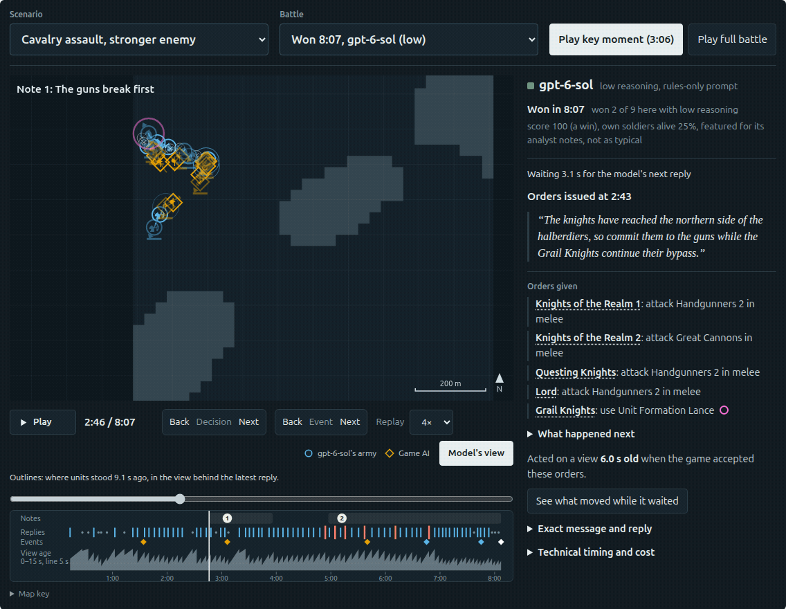
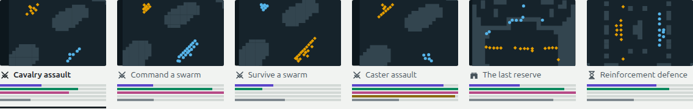
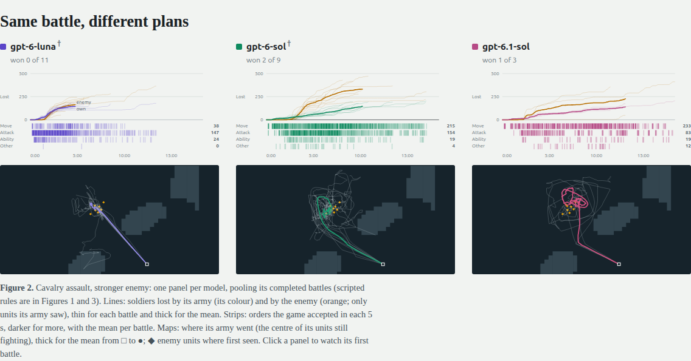

# Game agents: Slay the Spire & Total War: WARHAMMER III

Language models playing the original games: building a deck and choosing a path through
**Slay the Spire**, or commanding cavalry, spellcasters and entire armies in
**Total War: WARHAMMER III**. The games run on Windows; Python controllers in WSL read
public game state and send actions through mods. Every decision leaves a trace you can inspect.

In Slay the Spire, a bad choice can end a run an hour later. In WARHAMMER III, the battle
keeps moving while the model thinks. This project explores both: how agents plan, how
their interfaces help or hinder them, and what actually happens when their decisions
reach the game.

[](docs/twwarhammer3/reports.md)

*A recorded cavalry flank from the WH3 report, replayed at 4×. Blue circles are the
model's units; gold diamonds are the game AI. Outlines show the older positions the model
saw. Actual battles always run unpaused at 1×. [Still image](docs/images/wh3-replay.png)
· [Report guide](docs/twwarhammer3/reports.md)*

[WH3 benchmark](docs/twwarhammer3/benchmark.md) ·
[Slay the Spire full runs](docs/spire/fullrun/README.md) ·
[Current work](docs/state.md) · [Setup](#setup)

## Two games, two kinds of decisions

| | Slay the Spire 1 | Total War: WARHAMMER III |
| --- | --- | --- |
| Task | Complete Ironclad runs at Ascension 0 | Command custom battles against the game AI |
| Decisions | Cards, targets, potions, rewards, shops, events and map routes | Movement, attacks, formations, spells, abilities and supported battle objectives |
| Interface | Labeled legal choices through CommunicationMod | Structured observations and orders through a custom Lua mod |
| Time | Turn-based decisions with memory across a run | Continuous battle; observation-to-order delay is measured |
| Investigation | Which prompt and memory changes fix observed mistakes? | Can a model find a winning tactic and execute it in time? |

## WARHAMMER III: watch the decisions unfold

The benchmark puts models in deliberately different tactical situations: cavalry facing
anti-large infantry, a caster-led assault, commanding or surviving a Skaven swarm,
a siege defence and a reinforcement defence. The aim is a small set of difficult,
winnable battles with meaningful choices.

[](docs/twwarhammer3/benchmark.md#scenario-design)

Models can issue orders directly (`llm` / `llm_rules`), or act as an asynchronous
`commander` that assigns tasks to a scripted skill executor. Scripted baselines provide
reference points. Controllers can rotate over rematches of the same battle, and the
harness supports OpenAI and OpenRouter models as well as
[external Python controllers](docs/twwarhammer3/benchmark-run.md).

The **offline HTML report** is the best way to explore a saved experiment:

- **Replay the battle.** Scrub through recorded unit positions, routes, spells and
  objectives; jump between decisions and analyst notes.
- **Inspect a decision.** Read the model's exact message and reply, accepted or refused
  orders, and what moved while it waited. The “Model's view” overlay makes latency visible.
- **Compare behaviour.** See casualties, order patterns and army routes alongside outcomes,
  order age and API cost. Inspect game stills where recorded.

[](docs/twwarhammer3/reports.md)

*Same scenario, different plans. Lines show soldiers lost; strips show accepted orders;
maps trace army movement. These are development results from the report snapshot of
16 October 2026. Settings are pooled where marked †, and prompts were developed on these
scenarios. The six candidates remain provisional. [Figure details and provenance](docs/twwarhammer3/reports.md#readme-visuals)*

The report opens locally with its replay data, figures and images embedded—no server
needed. The full report and raw runs are local artifacts, so a clone includes these
previews and the tooling. With the saved jobs available, rebuild the suite report with:

```bash
uv run python -m twwarhammer3 report --jobs-file configs/twwarhammer3/benchmark_jobs.json \
  --output runs/twwarhammer3/reports/benchmark
# Open runs/twwarhammer3/reports/benchmark.html in a browser.
```

[How the mod works](docs/twwarhammer3/README.md#how-it-works) ·
[Benchmark design](docs/twwarhammer3/benchmark.md) ·
[Results and experiment log](docs/twwarhammer3/log.md) ·
[Trace exports for future training](docs/twwarhammer3/traces.md)

## Slay the Spire: a whole run of consequences

The model makes decisions from Neow's opening offer onward: what to play, what to buy,
which cards to take, when to rest, and which path to risk. It receives a public state
summary, labeled choices, recent decisions and its own persistent notes. Saved traces
show the choice, its stated reason, and the consequences on later floors.

The development loop starts with an observed mistake, changes one part of the prompt,
memory or interface, then compares another set of runs. **The furthest recorded run
reached Act 4, floor 54; no run has won yet.** The current v10 scaffolding awaits a
completed evaluation after its first job was interrupted.

Earlier work built a reproducible first-combat benchmark with scripted policies, PPO and
a local Qwen LoRA. The LoRA matched the heuristic's average remaining HP on a small
three-encounter development catalog; PPO changed its weights without improving play.
Those experiments are paused, and remote open-weight training is planned.

[Full-run loop and findings](docs/spire/fullrun/README.md) ·
[Run history](docs/spire/fullrun/log.md) ·
[First-combat experiments](docs/spire/first-combat/README.md) ·
[Open-weight plan](docs/spire/open-weight/README.md)

## What makes a run inspectable

- **Public information only.** Spire policies get legal choices and an unordered draw
  pile unless the game reveals its order; no seed or RNG state. WH3 policies see enemy
  units only while visible to their army, plus the roster shown before battle. Replay
  imagery and evaluation-only state never enter their prompts.
- **Results from the engine.** Wins, deaths, losses and draws come from the game.
  Infrastructure failures, invalid replies and interrupted jobs are recorded separately.
- **Reproducible evidence.** Jobs record source revision, configuration, game/mod pins,
  observations, actions and model usage. Recorded play requires a clean source scope and
  a fresh output directory.
- **Budgeted model calls.** Spend is recorded in append-only ledgers, with a worst-case
  reservation before each paid request. `--budget-usd` caps the selected ledger's total,
  including earlier jobs.

Shared transport, spend accounting, provenance and Windows process supervision live in
[`src/gameai/`](src/gameai/). Each game owns its interface and episode loop. Code layout
and contribution rules: [AGENTS.md](AGENTS.md). Evidence layout: [runs/README.md](runs/README.md).

## Setup

Running games requires **WSL, the installed Windows Steam games, and Windows Python 3.13
at `C:/Python313/python.exe`**. The repository pins game/mod versions and local install
paths; check the integration guides for [Spire](docs/spire/integration.md) and
[WH3](docs/twwarhammer3/integration.md). Game binaries, mod jars, saves and API keys are
not included. Offline tests and report generation do not launch a game.

```bash
uv sync --locked
uv run pytest
uv run ruff check .
uv run python -m spire doctor         # read-only runtime check
uv run python -m twwarhammer3 doctor  # read-only runtime check
```

Spire uses the Steam Workshop versions of ModTheSpire, BaseMod and CommunicationMod.
WH3's Lua pack is built from this repository at launch; launching also installs a
persistent startup-video skip ([details and reversal](docs/twwarhammer3/README.md#commands)).
Run one game controller at a time across both games.

### Play a battle

Start with a scripted controller, which needs no API key:

```bash
uv run python -m twwarhammer3 play --policy attack_nearest --scenario kho5-dwf5 \
  --output runs/twwarhammer3/battle/example
uv run python -m twwarhammer3 digest runs/twwarhammer3/battle/example
uv run python -m twwarhammer3 report runs/twwarhammer3/battle/example \
  --output runs/twwarhammer3/reports/example
```

For a model controller, use `--policy llm_rules --model gpt-6-luna --effort low
--budget-usd 25` in place of `--policy attack_nearest`, with credentials configured below.
`--scenario random --seed 2` draws a map and both races and autogenerates the armies.
See the [WH3 commands](docs/twwarhammer3/README.md#commands) for rotations, live watching
and other scenarios.

### Play a full run

Both games accept `OPENAI_API_KEY` or a key file named by `SPIRE_OPENAI_KEY_FILE`.
WH3 also supports [OpenRouter credentials and models](docs/twwarhammer3/controllers.md#openrouter).

```bash
export SPIRE_OPENAI_KEY_FILE=~/.config/robocasa/openai_api_key
uv run python -m spire play --model gpt-6-luna --effort low --seed RUNDEV1 \
  --budget-usd 25 --output runs/fullrun/example
uv run python -m spire digest runs/fullrun/example
uv run python -m spire digest runs/fullrun/example/run-0000 --picks
```

The example budget is a ledger ceiling, not an extra $25 allowance. Spire and WH3 keep
separate ledgers; WH3's OpenRouter ledger is separate again. Current runs, budgets and
next experiments are tracked in [docs/state.md](docs/state.md).
