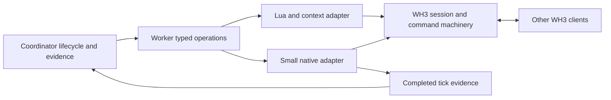

# WH3 multiplayer control foundation

Plan, 2026-11-03. **A stronger control API is viable; a fully UI-independent route is
conditional on identifying and checking a few native engine operations.** Keep WH3's
multiplayer transport and simulation, expose its missing session operations, and establish
a trustworthy synchronization check before expanding control.

The original request was investigation and a document for later implementation only.
On 2026-11-04 the owner requested implementation of this plan. The paid VM continuation
remains stopped; new spending is not authorized by this document. This supersedes the
"not started" API investigation in [the earlier next steps](mp-next-steps.md#later-a-multiplayer-friendly-mod-api),
not the status of its already-built code. The paid VM continuation remains stopped.

## Implementation status

2026-11-04, branch `wh3-multiplayer-foundation`: stage 1 in progress. A bounded passive
reference probe (`engine/multiplayer_probe.py` and `.js`) follows deployment callback
dispatch to its dynamically resolved handler. It hashes the actual process image, checks
all hook signatures/layouts before attaching, and records source-side Windows wall times,
per-invocation identities and diagnostic completed-tick checksums after worker join.
It exposes no commands and does not execute Lua or checkpoint restoration.

Static trace on pinned 26403568: the `BattleDeploymentEndMP` constructor at RVA `0x1bdebc8`
installs vtable `0x37c45f0`; its `+0x188` dispatcher at `0x1bef0c0` resolves named handlers
through `0x22db234` and runtime table `0x448ff18`. That table's values are not available
from the retained file image. A normal reference action must identify the handler before
the underlying session operation can be traced or invoked. No native lifecycle operation
has been promoted to an adapter. Evidence: `runs/wh3-multiplayer-foundation/`.

The capture helper runs under the existing Windows Frida Python as
`python -m twwarhammer3.engine.multiplayer_probe --pid OWNED_PID --output FRESH_DIR --seconds N`.
Its caller must own the game; attach before constructing the reference battle. It never
launches or closes a game. A `STOP` file ends capture. An error or missing `ready` exits
nonzero; zero means only that capture ran, not readiness, synchrony or acceptance.

The initial component checks exercise guards and bookkeeping, not ABI correctness.
Raw witnesses, native submission counting, phase/ending readback, peer calibration,
confirmed operations, warm reset and the complete acceptance cohort remain outstanding.
Historical `compare-peers` behavior is unchanged. One local reference (`foundation-ref1`,
`77124d4`, build 26403568) captured 103 consecutive ticks without read errors, but zero
deployment callback traces despite one acknowledged UI click on the shown multiplayer
panel. The candidate generic event dispatcher did not establish the readiness operation.
The game closed after deliberate truncation; its final observation was only 8.4 seconds
after logged start, short of the ten-running-second card. The pre-stop manifest counted
102 ticks versus 103 in the final stream; the independent recount preserves both. No peer
replication, observer passivity or direct operation is established by this reference.

Next bounded discovery question: trace the actual `SimulateLClick` path. Static registration
at RVA `0x41fe10` binds it to `0x22d1eb8`, which forwards the component at wrapper `+0x20`
to `0x22d1ed0`. That routine calls `0x22ba824`, `0x22bab38` and `0x22bb900`; identify which
call submits local readiness, with a normal reference, before promoting any binding.
That registration is the Cco proxy, not the script method: `foundation-ref3` at `608aaab`
loaded its hooks and ran the battle but recorded no scope/targets. A separate name/function
table at `0x3d46900/08` binds the script method to `0x22d1f58`; it calls `0x22d19a0`,
which reaches the same down/up dispatch. The scope hook now watches that entry and labels
its incoming object as an opaque script wrapper. Fresh live evidence is still required.
These are discovery leads, not operational addresses. No cloud job has run here.

The next passive trace scopes those input-dispatch call sites to a battle's
`SimulateLClick` invocation and originating thread. It records targets before the call
instructions, with distinct duplicate/nested click IDs; it rejects stale environment
generations. All eleven signatures are checked before attaching. These records are
candidate call targets, not native-submission counts or completed readiness actions.
The first attempt with that trace (`foundation-ref2`, `5bf2424`) aborted before native
ready or lobby setup: Frida could not intercept the short call instruction `0x22bad02`.
The helper reported failure and closed the owned game. The first two hooks now sit at
`0x22bacfd` and `0x22bad3a`, where R9/RAX are populated before final argument setup.
Raw register snapshots are not function arguments. This patch-site change remains
unverified until a fresh reference; the failed attempt is retained.

`foundation-ref4` at `8bd3c55` reached the script scope: one paired click and five target
records, plus 134 consecutive completed ticks without errors. Its retained running
window was 11.1 engine seconds after the first Deployed observation; game/helper closed.
The underlying session readiness operation is still unidentified: the observed UI
handlers emit signals through `0x9070c0`. Next bounded question is which signal receiver
handles readiness, before promoting any operation. Targets before instructions do not
establish submission, direct control, passivity or replication. Owner stopped this work
for continuation in another session; handoff `runs/wh3-multiplayer-foundation/handoff.md`.

Overnight 2026-11-04 (Claude, branch `wh3-mp-witness`; evidence and notes in
`runs/wh3-mp-overnight-20261104/` and `runs/twwarhammer3/native-multiplayer/foundation-ref5-load-refused`,
`-ref6`, `-ref7`, `-ref8`, `-typed1`). Following the typed command names instead of UI signals
answered the "next bounded question" above. One client only, $0, in one 30-minute window lent by
the benchmark session, so nothing here speaks to another peer. Status is unverified: no check
is agreed, and each row below rests on the n named.

| Step | Build 26403568 | Live |
|---|---|---|
| Lobby ready | `CustomBattleLobbyContext.ToggleReady`, no component lookup; the flag follows after a delay | ref6, 1 run |
| Button | Receiver `0x1c3bc48` compares the component name with `button_battle_start` | ref6, 1 click |
| Sender | `0x1bfa108(battle interface [0x448f180])`, flag `+0x15cf` set before its checks | ref6, 1 click |
| Command | `BCQ_ARMY_ORDER_END_DEPLOYMENT_PHASE` (id is the name's hash), written to input stream `env+0x644e8`; every typed command starts at `0x1bd09b0` | Packet seen: ref6, 1 click. ref8: the adapter's call raised the stream offset 0 to 17 and execute ran; the passive packet hooks do not see that call |
| Execution | Handler `0x2ed483c` gets `[env+0x440]`, counts at `[[env+0x440]+0x150]+0x9b8`, and sets countdown `+0x9b4` to 600 ticks; the count is anonymous | ref6 and ref8 |
| End of deployment | `0x2db7cc0`: count reaches the human armies; the countdown suggests the engine does not wait forever | static only |
| Phase | `[env+0x448]+0xc8`, a client-side copy, went 0, 3, 2, 4, 5, then 6, 8 at the ending; click at 4. Simulated phase `[state+0x28]` is recorded from the next capture on | ref6 and ref8 |
| Outcome | `[0x448f208]+0x5d0` decided, `+0x5cc` zero-based winner; agreed with Lua's result | ref8, 1 battle |
| Direct ready | Adapter's fixed call to the sender at `session_step`, no click and no component lookup; it needs the battle-interface object, so this does not show headless use | ref8, 1 battle, at phase 0. Current code asks only in phase 4 and has not run live. No run withheld readiness, so this rests on the count row and timing, not on a control |
| Leave | Global `QuitToMainMenu` | Ack ok and frontend reloaded, ref6 (from Deployed) and ref8 (from Complete). The game's own leave lines were read during ref6 and not kept |
| Create, join | No direct route yet. Host request `0x21be4c8` is a native call, but the host popup object assembles its arguments (name and password from its settings, a preset from its own list, then `0x21ece30` and `0x21b6068`); `mp_automatch` sits in a debug frontend. A direct create would have to rebuild those, which needs live iteration | none |

Three results are not successes. **Warm reset failed its one attempt** (ref6): after leaving,
the same process did not get back to the games list; the automatic steps failed at the multiplayer
menu, two manual retries failed too, and the game was then closed by hand, so only the
first failure is clean evidence. **Two of the four launches that reached the frontend stalled**:
ref7 was about 100 s late at its multiplayer click, then silent for 149 s until stopped by hand;
typed1 stopped logging 21 s after the capture was ready, its frontend script loaded, and it ended
at its 270 s bound. The cause is unknown. The adapter, the five added passive hooks, fast
relaunches and the earlier frontend hang with no probe (log, 2026-10-14) are all open.
**The typed worker route has no live run past `status`**: typed1's `create_lobby` was written
and its result is unknown. `ref5-load-refused` was a fifth launch, closed at load, since fixed.

On one client, in ref8, raw witness ids and x, z matched Lua's unit rows: 604 rows, ids exact,
and on the 212 rows at equal times x and z agree within 5e-12. The largest gap elsewhere, 2.26 m
on an axis, comes from Lua and the witness being up to 200 ms apart on moving units. Men and bearing
matched at two snapshots. Hit points did not: that capture's words were not hit points (the
maximum and a zero), so the current code sums soldiers instead, which has not run live.
`compare-peers --native` gives `agreed` for a capture against itself and `conflict` for ref8
against ref6 (118 of 134 checksums differ, from tick 16); that shows it tells two different
battles apart, not that two peers agree. Tick origins, unit identity and field comparability
all need one two-client reference.

## Owner decisions and completion

The owner selected these directions during the investigation:

- **Small targeted native hooks:** reuse checkpoint tooling where context commands cannot
  expose an operation, accepting build-specific maintenance.
- **Lifecycle plus synchronization evidence first:** two-client setup, readiness,
  running/ending/reset, existing move commands and reliable replication evidence. Other
  tactical actions follow later.
- **UI only as a temporary route:** "I'd rather avoid depending on the UI. In the future
  we'd still like to investigate the possibility of a headless run." A UI-dependent
  adapter can support intermediate testing but is not the permanent solution.
- **Acceptance structure:** six scheduled fully automated matches, three per host, plus
  targeted failure tests, exact-tick evidence and no manual recovery in passing matches.

The detailed engineering/check choices below remain proposals where marked. The selected
acceptance structure is not a live pass or blanket approval of every proposed parameter.
Before implementation, resolve the marked choices in its cards and register the complete
repeatable procedure in [agreed checks](../agreed-checks.md), preserving that distinction.

Completion has two separate criteria:

1. **Operational foundation:** the acceptance and failure checks pass at a recorded revision.
2. **Direct control:** every required lifecycle operation works without locating or invoking
   a UI component. A native call that still requires a widget does not meet this criterion.

This preserves a path toward headless research. It does not establish that WH3 can run
without its UI runtime, renderer, window message processing or graphics device. Renderer
removal remains a separate investigation in [the multiplayer plan](native-multiplayer.md#headless-a-deeper-bounded-investigation).

## Viability and evidence

The investigation inspected source at `8029e1b`, retained multiplayer evidence and the
installed 9.0.5/build 26403568 layouts. It performed no new live probe. The document was
prepared from `210e356`; the later checkpoint change does not prove any multiplayer binding.

| Operation or mechanism | Concrete evidence | What remains to establish |
|---|---|---|
| Lobby readiness | Installed `custom_battle.twui.xml` binds `ContextCommandLeftClick` to `CcoCustomBattleLobby.GetIfElse(IsFactionSelectionCountdownPhase, ToggleFactionLockReady, ToggleReady)`. Context documentation exposes `IsLocalPlayerReady`, local slot and host identity. | Direct invocation, authoritative readiness readback and replication on both clients; context access without a widget. |
| Deployment readiness | Installed `deployment_end.twui.xml` contains two `button_battle_start` components and `BattleDeploymentEnd` / `BattleDeploymentEndMP` callbacks. | The session operation below the UI callback, its thread, arguments, local-player authority and completion signal. |
| Create and join | Installed host/browser layouts name `MPHostGamePopup`, `MPOnlineCustomBattles`, `MPGamesList` and `BattleListGameInfo`. The prior context audit found no documented create/join commands. | Reachable session operations that preserve WH3 initialization and networking without depending on a panel. |
| Checkpoint hooks | Native code already identifies engine sessions, completed ticks, checksums and safe battle-thread Lua execution. | Which hooks and identity/checksum semantics also hold in native multiplayer and the frontend. |
| Existing multiplayer moves | First battle: 79 compared Lua times, 553/553 exact unit rows. Second: 34 times, 238/238 exact rows, all in its idle lead-in; moving-phase samples no longer shared times. | Complete-tick comparison, submission counts and normal engine endings; neither retained attempt has a final observation. |

The layout findings explain why a button ID alone was ambiguous. They identify tracing
targets, not callable native function addresses. The absence of a documented Lua binding
does not establish that no internal operation exists.

Evidence locations, deliberately outside Git:

- `runs/twwarhammer3/native-multiplayer/lobby-static-audit.md` (older build; context leads).
- Installed `data/ui3.pack`: `ui\frontend ui\custom_battle.twui.xml`,
  `popup_host_game.twui.xml`, `mp_games_list.twui.xml`, and
  `ui\battle ui\deployment_end.twui.xml` (read in memory on this build).
- `runs/twwarhammer3/native-multiplayer/lobby-map-20261103/` and `tb2/` (local UI evidence).
- `runs/twwarhammer3/native-multiplayer/mp1/combined/` and `mp2/combined/` (independently
  recounted using the current comparator; equal to the retained comparison outputs).

The current [comparator](../../src/twwarhammer3/battle/peers.py) joins equal Lua `time_ms`
and compares position, type and UI ID, not a complete engine snapshot. The fixed observation
grid prevents acknowledgements from moving regular sample times; it does not make reads
atomic at a common completed tick. Moving units on both screens is useful replication
evidence, but does not establish exactly-once submission or full synchronization.

[Checkpoints](checkpoints.md) rebuild a replay's setup/input history with a captured Lua
seed, then switch to a local live input provider. They do not serialize and restore peer
membership, transport state or a whole multiplayer session. Reuse their discoveries, not
the restore procedure. The first strict 9.0.5 Land run also found cached-stat differences
despite matching tick checksums; the subsequent live-value rule is a separate checkpoint
change. Hashes alone do not settle all state comparisons.

CA warns that UI-triggered changes to model state can desynchronize multiplayer
([documentation](https://chadvandy.github.io/tw_modding_resources/WH3/ui_scripting.html)).
The engineering target is WH3's normal session and replicated-input path. Calling a local
state setter from native code does not make it a networked operation.

## Proposed architecture

JUDGEMENT: Adapter boundary — Codex, 2026-11-03: extend the existing worker with typed
operations and small context/native adapters. A separate service or state replication
protocol changes ownership and failure handling; the architecture below rests on this.

Keep the existing coordinator, native Windows workers, local mailboxes and game clients.
The coordinator manages participants, lifecycle and evidence. Each worker owns its client
and validates commands. WH3 owns multiplayer transport and simulation.

### Operations and results

Extend the existing worker command channel; do not introduce another network service.
The proposed operations are:

| Operation | Required behavior |
|---|---|
| `status` | Read phase, session generation, local player/army, host, participants, readiness and available operations. Identify any temporary UI backend. |
| `create_lobby` | Create the declared custom-battle lobby; confirm identity and requested configuration rather than returning success on invocation. |
| `join_lobby` | Join the specified lobby and confirm the expected host and participants. Never select a lobby by display name alone. |
| `configure` | Apply existing scenario settings and permitted slot/army changes, then read back the declaration on both clients. |
| `set_lobby_ready(bool)` | Read actual local readiness and reach the requested state. A repeated request must not toggle it back. |
| `ready_deployment` | Submit this player's readiness once and confirm it. WH3 decides when all peers are ready and the battle begins. |
| `leave` | Leave the session and confirm its destruction before starting another attempt. |

Keep existing move orders as tactical commands. No generic native-call, arbitrary Lua or
memory-write interface is part of this API. Use a small fixed operation list, not a plugin
registry. Reuse existing match/attempt/client/request IDs and one outstanding command per
client; add only the native session generation and operation/result fields needed here.

Separate receipt, invocation/submission, observed readiness and phase transition. A native
function returning, a successful click or a Lua acknowledgement is not a completed action.
Retain existing acknowledgement/lease bounds; loading and other asynchronous transitions
need their own explicit operation deadline rather than borrowing the acknowledgement bound.

Use existing context commands first, then narrowly exposed native operations. A UI fallback
must be explicitly selected and recorded as temporary; never silently switch backends after
an ambiguous submission. Ordinary rendered UI may remain present during direct-route
verification, but the adapter must resolve session/model objects without component lookup.

### Engine authority and execution

Only the originating client submits an action. Other clients receive it through WH3.
Do not distribute equivalent local state changes to every peer or build an external
lockstep system. Preserve the current move route while tracing its native submission;
replace it only if the investigation demonstrates a defect.

Steam's `CreateLobby`/`JoinLobby` are matchmaking primitives, not evidence that WH3's
session, roster and loading state are initialized
([Steamworks](https://partner.steamgames.com/doc/api/ISteamMatchmaking)). Trace WH3's own
operation before considering a platform call. Keep WH3 lobby IDs distinct from Steam
"ghost lobby" IDs; logs are diagnostic evidence, not the sole session identity authority.

Use Frida already employed by checkpoints. Verify executable hash, native signatures and
required layouts before enabling a capability. A mismatch disables that capability and
reports the build; it does not silently re-pin or change the normal runtime warning policy.

Discover frontend execution points separately from battle hooks: deployment cannot depend
on a simulation tick that has not begun. Queue commands and execute at identified safe
points on the owning game thread, rechecking phase, session generation and authority there.
Preserve the Lua stack where applicable and reacquire objects after transitions. Network
and file work stay off the game thread; bounded state copies happen there.

Thread identity alone is insufficient: Frida cautions that arbitrary thread scheduling can
interrupt non-reentrant code ([Frida API](https://frida.re/docs/javascript-api/)). Establish
a safe execution point for each required phase; do not assume one battle hook covers menus,
loading and results.

### Failures and recovery

Check host authority for settings and native local-player identity for army changes.
Configuration or membership changes invalidate prior readiness evidence. Before readiness,
both clients must agree on the declared setup and participants. Do not assume the joiner is
slot 1 or that identical unit types identify the same unit.

Re-reading an existing request's recorded status is permitted; repeating its engine action
is not. If submission may have happened and authoritative readback cannot resolve its
effect, fence the attempt: reject further commands under that identity and abort. Do not
claim transactional exactly-once execution across process crashes.

Unexpected migration, a lost peer, changed session identity or lost ownership also aborts.
No automatic desynchronization repair or continued evaluation of a subset of peers.

## Implementation sequence for later

Each stage is a separate small change with its behavior, independent reference and check.
Keep implementation worktrees separate from the active checkpoint work. Preserve normal
single-player behavior and checkpoint restore checks throughout.

### 1 Identify and prove the missing engine operations

JUDGEMENT: Discovery order — Codex, 2026-11-03: deployment readiness, then create/join
and leave, before broader automation. Starting with lobby creation could expose its main
risk sooner; this delivery order rests on the narrower readiness probe succeeding first.

For each operation:

1. Follow the installed layout callback registration into the native implementation.
2. Trace one ordinary reference action: session object, arguments, ownership checks,
   thread, submission route and completion notification.
3. Locate the operation beneath widget handling; implement only the smallest experimental
   binding needed to call it at the correct execution point.
4. Compare its effects with the reference action, including the other client's readback.
5. Record build, call site, object lifetime, preconditions, network effect, completion signal
   and any remaining widget dependency before promoting it to the operational adapter.

Use the one-human multiplayer test bed for local lifecycle probes. Joining, propagation
and synchronization conclusions require two clients. UI reference actions are appropriate
for discovery; they do not satisfy the final direct-control criterion.

If only a widget-dependent callback, raw state patch or unproven local mutation is found,
stop that capability at the identified limitation. Do not continue broad reverse engineering
without a new bounded question. A callback name/string is a lead, not an implementation.

### 2 Establish a passive synchronization observer

Reuse the discoveries in `engine/checkpoint_agent.js`, especially `post_tick` and the
`session_step` completed-tick boundary after worker jobs join. Do not load that agent
unchanged: it writes replay/debug state and contains restoration/test-hook behavior.
Keep restore code separate from the passive implementation.

JUDGEMENT: Raw witness — Codex, 2026-11-03: checksum each completed tick; identity,
position, orientation, men/health, ammo and routing every ten ticks and around commands.
Other fields/cadences change cost and detectable divergence; this observer rests on these.

At the safe boundary, capture the Raw witness records, phase, engine ending and source-side
Windows timestamps. Define "around commands" as the last completed state before submission
and the first completed state after it; label unavailable application ticks honestly.
Preserve numeric precision. Keep omniscient samples and native IDs evaluator-only, never
forwarded to a policy. Sample collection must not wait for another client or policy.

Calibrate cross-peer tick origins, hashes and identity mappings before comparison. Add a
versioned completed-tick mode to `battle/peers.py`; retain the old Lua-time mode for historical
evidence. Compare raw state independently of checksums, using only fields established as
comparable by the reference. If a required field/hash cannot be calibrated, report the
missing capability rather than silently dropping it to pass.

Require every scheduled checksum and raw sample in the declared common running interval.
Missing evidence is inconclusive; repeated conflicting records are failures. Never compare
nearest wall times, interpolate missing ticks or add a tolerance to hide disagreement.
Record per-client loading/start/end boundaries as well as the common interval so selecting
an overlap cannot conceal a missing start, stalled peer or incomplete ending.

### 3 Implement confirmed lifecycle operations

Replace multiplayer UI sequences incrementally with the typed operations. Reuse existing
scenario recruitment/settings code and native ownership readback. The lifecycle is:

`frontend → lobby → participants/configuration confirmed → ready → loading → deployment
→ running → engine ending → leave`

Transitions require engine evidence and bounded deadlines. Sleeps can pace polling but
cannot establish completion. In particular, readiness is per player; never call
`end_current_battle_phase` as a substitute. Verify an advancing engine clock after entering
the running phase. Preserve all refused, failed and unknown results.

### 4 Add fresh matches and the bounded runner

JUDGEMENT: Reset lifetime — Codex, 2026-11-03: retain owned clients after a normal ending,
with fresh attempt/link/mailbox scopes inside an outer process scope. Cold restarts every
match are simpler but slower; warm-reset design and its checks rest on this choice.

`engine/worker.py` currently couples one owned game to one attempt. For the proposed warm
reset, drain both endings, leave, confirm the old session is gone, invalidate old requests
and native handles, then establish a new attempt. The frontend, battle Lua and native
adapter must acknowledge the new binding before accepting commands. A persistent frontend
cannot keep its previous job ID. Keep session isolation even when the process survives.

Any ambiguous failure closes owned clients; recovery uses new processes and attempt IDs.
Do not use `--attach` as a substitute for ownership. Preserve default single-attempt behavior
for existing callers; the new runner manages a bounded sequence, not a persistent service.

Follow the pinned [PySC2 multiplayer test](https://github.com/google-deepmind/pysc2/blob/0df53d38c153972f1e368572ba65b1442a0fd41f/pysc2/tests/multi_player_test.py)
for explicit create/join/player identity, repeated matches and cleanup. Its synchronous
stepping is not suitable for live WH3. Name this reference in implementation cards/comments;
outside sources and limitations are in [references](../references.md#wh3-multiplayer-control-foundation).

## Verification procedure for later

The owner agreed the six-match acceptance structure; no new capability has passed it.
The marked refinements below must be resolved in the complete check before it runs. No new
pytest tests are needed merely to save this document.

### Calibrate the reference first

JUDGEMENT: Calibration sample — Codex, 2026-11-03: two ordinary native reference battles,
one per host, with passive observers before automated acceptance. More references broaden
coverage; the observer calibration here rests on this limited sample.

Run the Calibration sample using ordinary UI/native-player actions. Establish tick/hash
comparability, local ownership and stable identity mapping, including duplicate unit types
and a non-first allied army. Check that observation does not acquire control, change the
seed, input provider, speed or battle state. Keep raw witnesses alongside hashes.
Calibrate submission counting with one ordinary player move, then two separately issued
identical player moves: require one versus two recorded submissions. This checks that the
collector itself does not lose or combine duplicate calls; planted trace edits alone cannot.

Freeze a small legal fixture from the existing two-human/AI setup, using the second
account's confirmed recruitable units. Confirm ordinary combat reaches an engine ending;
do not add force-end to manufacture completion. Freeze revision, installed builds/packs,
map/rosters/settings, observation schedule and operational deadlines before acceptance.
The exact fixture and deadlines belong to that later check card, not an improvised live run.

Keep the existing [host/display check](gcp-client-setup.md#5-one-client-test) unchanged.
Use source-side Windows clocks for engine-rate evidence, not WSL/coordinator arrival time.
Its pass is scoped to the tested host configuration; this plan does not extend its tolerance
or turn a constant speed flag into evidence. Report observer overhead and actual rate.

### Six scheduled automated matches

JUDGEMENT: Reset sample — Codex, 2026-11-03: within the owner's three matches per host,
use one cold start followed by two warm fresh matches. All-cold starts would not test
retained process state; warm-reset acceptance rests on this distribution.

Schedule the owner's acceptance cohort at one frozen revision/configuration. Each match
must create, join, configure, ready, deploy, run, finish and leave without clicks or manual
recovery. A failure stays in the cohort; do not keep replacing attempts until six pass.
A new cohort after a fix records its new revision and retains the previous failures.

JUDGEMENT: Movement window — Codex, 2026-11-03: collect at least five seconds before and
thirty seconds after each isolated A/B movement witness, then through the normal ending.
Other intervals change sensitivity to delayed divergence; movement evidence rests on these.

Each match checks:

- Both peers read back the declared settings, membership and native local ownership.
- A-only movement, B-only movement and overlapping requests affect the intended armies
  on both clients; one delayed policy does not block the other's requests or simulation.
- Movement evidence rests on JUDGEMENT docs/twwarhammer3/multiplayer-control-foundation.md
  Movement window; sampling rests on JUDGEMENT docs/twwarhammer3/multiplayer-control-foundation.md
  Raw witness. Every planned sample is present and exact where the reference established comparability.
- Native submission tracing counts invocations separately from observed movement; duplicate
  identical moves can otherwise look like one move.
- Both clients report the same victorious alliance/result reason after identity mapping.
  Local won/lost labels need not be identical when clients oppose each other.
- The match stays unpaused at 1x, records source timing and returns to a known reusable state.

A timeout is truncation, never a gameplay loss or success. Missing required evidence is
inconclusive. A remaining UI backend is temporary and cannot satisfy direct-control
completion even if operational automation passes. Report the two criteria separately.

### Faults and checks of the checks

JUDGEMENT: Fault coverage — Codex, 2026-11-03: use offline planted faults for protocol
and comparison cases, live readiness stages and separate interrupted recovery attempts.
Broader live fault campaigns change coverage/cost; this acceptance rests on this split.

| Case | Independent check and required result |
|---|---|
| Duplicate/stale command; old request after reset | Replay it against the adapter; reject stale identity and show at most one submission for a duplicate live request. |
| Wrong host/player/army | Refuse before engine mutation; include another allied army and duplicate unit types. |
| Hidden or duplicate UI component | Temporary adapter refuses ambiguity or selects the uniquely valid component; final direct adapter performs no component lookup. |
| Lost reply | Query recorded status without resubmitting. A live deliberately dropped result tests the unresolved-effect abort path. |
| Missing tick/participant, conflicting record, changed raw value | Plant each in retained evidence; comparator must not report a passing synchronized match. |
| Duplicate native submission | Plant a duplicate submission trace; the check must catch it even when positions match. |
| Unsupported signature or stale native object | Refuse the capability before invocation; never reuse a previous session's pointer. |
| Hidden-state leakage | Alter evaluator-only fields and confirm policy input is unchanged. |
| Withheld readiness or settings changed after readiness | Live staged checks show the game waits appropriately and old readiness evidence is invalidated. |
| Peer loss and recovery | Separate interrupted attempt is aborted, evidence preserved, then new owned processes complete a fresh attempt. It is not one of the six completed matches. |

Mocked native tests establish guards and bookkeeping, not ABI correctness or replication.
Trace native reference and adapter calls live to establish those. Keep fault outcomes
separate from engine gameplay outcomes. Neither six matches nor two references establishes
a general reliability rate, policy strength or a benchmark result.

## Scope and handoff

First scope: two native clients, custom-battle lifecycle, existing move commands, passive
synchronization evidence and fresh-match recovery. No attack/halt/ability/resource expansion,
four-client certification, native multiplayer checkpoint restore, automatic desync repair,
renderer removal, new scoring or second simulation protocol.

Store future evidence in the existing native-multiplayer run layout: per-client lifecycle
events, source timestamps, native observations/submissions, installed manifests, engine
endings and one match-level report. Preserve failed attempts and temporary-backend labels.
No new cloud resources, account setup or spend is required to write the plan. Future live
work uses the then-current game window, storage state and explicit budget; an expired disk
or stale quote is not assumed available.

At each implementation stage: agree its card/check, use focused tests with meaningful
planted faults, review the native boundary/comparison independently, and run `scripts/check.py`
before committing. Record passes only at tested revisions. The final report identifies
which operations are context-backed, native, temporary UI or unavailable, and which of
operational completion and direct control actually passed. If a direct operation is not
viable, name the concrete missing dependency and stop that capability there.
