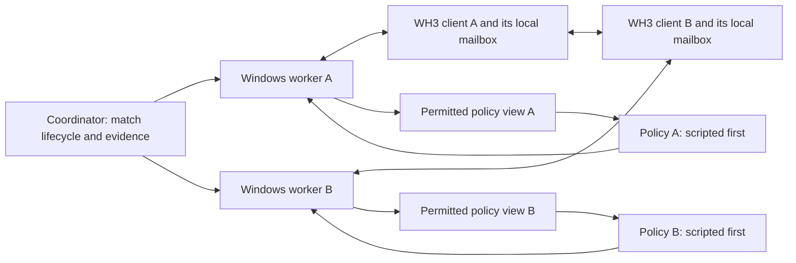

# Native multiplayer: investigation and implementation plan

Updated 2026-10-30. **Recommended route: ordinary Windows game clients, one client per
native player slot, a small Windows worker on each machine, and one Python coordinator.**
First prove ordinary multiplayer, then passive observation, then a Lua order sent by one
peer only. Automate the lobby and expand to native 2v2 after those checks pass. Use scripts
before models. Investigate lower rendering costs alongside this route, with a separate
proof before claiming a GPU-free client.

**On 2026-10-30 the owner asked to implement this plan up to the point where accounts and
billing block it ([status](#implementation-status)). Cloud accounts and resources and
purchases wait for the owner's accounts and billing; game launches wait for a game window
(plan step 1) and paid model calls for the owner's go-ahead.** The owner wants everything
possible prepared before spending. More concurrent game licenses are still needed. There
have been **zero live multiplayer battles** in this investigation; native control,
unattended operation, cloud compatibility and headless execution remain **unverified**.
The proposed checks below require the owner's agreement before they can verify a feature.
Nothing here changes [agreed-checks.md](../agreed-checks.md) or the benchmark definition.

Benchmarking/evaluation is the first intended use. [Later RL](#leave-a-path-for-rl) can reuse
the client and evidence interfaces; it does not require us to build a learner now. The
[existing multi-agent plan](multi-agent-plan.md) covers research questions and single-army
teams. A native client, player slot, army and model agent are different entities: four
clients with two agents per army cost four game machines and eight inference streams.
Two clients with split-army teams are native 1v1, not native 2v2.

Read [the approval items](#decisions-for-the-owner) first, then the
[sequence](#step-by-step-delivery). Provider runbooks, verification and headless research
are detailed below so the next change can take one small step without inventing its spec.

## Implementation status

2026-10-30, built on branch `wh3-native-mp`, merged to `main` at `5d10e2a`. Everything below was built and
tested offline. Nothing has run against a real game or a second machine, and the agent wrote
each part's card without the owner's agreement, so **nothing here is verified** under the
[hard rule](../../AGENTS.md#verification-hard-rule). Each part had a review by a second agent
and a fix round; the platform reviewer could not run the native tests; the author ran them,
and the doc check reran them at `f8ce78a` (the platform code is unchanged since). Authors and
reviewers planted wrong versions in every part. Each plant a reviewer found uncaught now fails
a new test, by the authors' reports (commit messages; not stored), including the two worker
plants first left as notes (a session read before hello in `--attach` mode, a worker that
prints its token; tests added in `047c96d`). Open review notes: check.py never runs the
native tests; in multiplayer `evaluation.friendly` counts only the local army while
`evaluation.enemy` counts every enemy army (marked below, not changed). Fixed 2026-10-31:
`first_difference_ms` counts a missing unit; compare-peers names the line of an events entry
lacking a field it reads (or with a non-object row or a non-number position), and reports
any other unreadable shape as a usage error, never a traceback. A seam test now runs the
comparator on evidence the battle Lua (under stubs) wrote through the real Mailbox, worker and
coordinator: two clients owning different armies compare exact.

JUDGEMENT?: Multiplayer friendly totals — orchestrator's card, `0c3ffcf` (2026-10-30): the
battle Lua's scan() registers only the local army as friendly, so `evaluation.friendly` omits an
ally's army. Summing the alliance would change any team measure read from it (none reads it yet).

| Part | Where | What it does | Evidence so far |
|---|---|---|---|
| Platform (steps 0, 2) | `gameai/windows.py`, `engine/runtime.py` | Under WSL, behaves as before (offline suite and review). Under native Windows Python: `C:/` paths, `sys.executable`, an `msvcrt` lock, a supervisor read without `select` | 2 new opt-in tests run this code under real Windows Python 3.13.1, with no game. With `GAMEAI_TEST_WINDOWS=1`, their two files (`tests/gameai/test_windows.py`, `tests/twwarhammer3/test_wh3_runtime.py`) passed 35 of 35, the 3 opt-in tests (2 new, 1 earlier) among them. Measured on the owner's PC, in both orders: a WSL `flock` and a native `msvcrt` lock on one file do not exclude each other, while two locks of the same kind do. Nothing enforces one kind of controller per PC; never run both kinds on one PC |
| Battle modes (steps 4, 5) | battle Lua, `mailbox.py` docstring, `protocol.HIDDEN_KEYS` | Session field `multiplayer`. `observe` never takes control, changes speed, ends deployment, restarts, clicks or advises. `control` accepts only unqueued `move` orders and takes a unit's controller at its first valid move. Ownership comes from `local_alliance()`/`local_army()`. The evaluator-only `native` identity section never reaches a policy | Lua 5.1 stub tests with a trap on every mutator; plants include `take_control` at startup and army 1 treated as own |
| Link | `engine/link.py` | Coordinator on 127.0.0.1 plus a standard-library worker client: tokens (only their sha256 in evidence), manifest comparison, numbered events, one command in flight, the worker's lease timed from its heartbeat's send time, the coordinator's from receipt, fencing | Fake workers over loopback: wrong token, other client, bad client names and event seqs, duplicate/reordered/conflicting events, lost status reply, lapsed lease, restarts |
| Worker | `engine/worker.py`, `twwarhammer3 coordinator`, `twwarhammer3 worker` | Joins one game's mailbox to the link: hello before touching the game; owned launch or `--attach`, which reads the session only after hello and refuses one of another mode; observations sent as evidence; `submitted` only on the game's acknowledgement. The coordinator removes its token files when the attempt closes; `play --attach` refuses a multiplayer session | Fake-game tests. One $0 native run at `b39a03d`: coordinator in WSL, worker under Windows Python 3.13.1 with `--attach --mode control` on a fake game: a WSL thread writing a temporary bridge under `C:/wh3-agent/`. Move submitted, attack rejected, worker exit 13.8 s after the coordinator closed by the WSL clock (about 14.8 s by Windows time, since WSL's clock runs 0.936×); no owned launch (`runs/wh3-native-mp-20261030/native-local-run/`) |
| Comparator (step 4) | `battle/peers.py`, `twwarhammer3 compare-peers` | Matches two clients' observations at equal `time_ms` by (alliance, army, index). Reports raw differences with no tolerance; ui_id disagreements are listed, never joined on. A time where one client has two different observations (finish() republishes at the same battle time) is listed as repeated and not compared (JUDGEMENT? `battle/peers.py` repeated time). A time where either client's `native` lists errors is listed for that client and not compared (JUDGEMENT? `battle/peers.py` failed read) | Synthetic evidence only, sent through the worker's own event code; it reads the native run's evidence (5 observations, none with `native`: the fake bridge writes none). Observation times are weaker than completed engine ticks |

Final checks after the five parts merged: an integration review found 1 blocker (compare-peers could
not read real worker evidence: fixed) and 1 should-fix (a failed read reported as missing
units: fixed), both in `047c96d`. A refusal sweep of link.py, worker.py and peers.py at
`f8ce78a` caught 12 of 18 refusals (link 10/13, worker 1/4, peers 1/1; 5 real gaps, 1
equivalent); rerun after `047c96d`: 18 of 18 caught. Neither sweep's counts were rerun by a
second agent. Files: `runs/wh3-native-mp-20261030/mp-sweep/` and
`runs/wh3-native-mp-20261030/mp-sweep2/`.

Research, git-ignored, each checked by a second agent:
`runs/twwarhammer3/native-multiplayer/quote-worksheet.md` gives public list prices, not a
quote. The worksheet anchors on São Paulo (from the owner's UTC-3 only; its
`JUDGEMENT?: Region` is in the git-ignored worksheet) and finds no G2 (L4) there, so it prices
us-east1. For 10 hours of one us-east1 client with the disk deleted (10 h and 250 GB rest on
JUDGEMENT native-multiplayer.md Cost workload, the g2-standard-4 + L4 vWS + Windows Server
shape on JUDGEMENT native-multiplayer.md Cloud candidate and Windows Server also on JUDGEMENT
native-multiplayer.md Worker platform; before egress, tax and streaming licences): $9.30, or $14.90 if the L4 vWS row is billed on top. airgpu at its lowest published
rates (per-region rates need sign-in): about $9.58–10.17 for an L4, or $7.08–7.67 for a weaker
T4, for the same 10 hours.
`lobby-static-audit.md` finds no documented create or join binding: the lobby's component ids
need owner-approved extraction of the shipped layouts or live UI dumps.

Running a worker on a Windows host (untested; the native run read this checkout through its
UNC path): install Windows Python 3.13 and check out the coordinator's exact revision without
line-ending conversion (`git clone -c core.autocrlf=false`, then `git checkout <revision>`),
adding no files under the source folders. The coordinator's checkout needs no other file there
either (uncommitted, untracked or git-ignored), since `source_sha256` hashes every file on disk
outside `__pycache__`. The game must be in the default Steam folder (`runtime.GAME_DIR` is
fixed), with its Steam build and `Warhammer3.exe` sha256 equal to the pins. Otherwise the
coordinator refuses the hello. Then run `python -m twwarhammer3 worker ...` with `PYTHONPATH=<repo>\src`; no other
package is needed.

Observer smoke, 2026-11-01 (one single-player battle, n=1, unverified): in `observe` mode
the owner's UI orders were obeyed and every card reading came out as expected; the card's
check of the check was not run ([log](log.md#2026-11-01-native-multiplayer-observer-smoke-one-battle)).

Blocked, and what unblocks each item:

| Next item | Blocked on |
|---|---|
| Low-graphics (H1) comparison; native completed-tick collector | A game window; the collector also needs its own card |
| Lobby automation (step 8) | Live UI dumps (game window) or owner-approved layout extraction; the owner's ruling on lobby privacy |
| Ordinary multiplayer, one-peer move, authority and visibility checks (steps 3, 5, 7) | A second concurrent licence and Steam account; agreed checks |
| Hosted client (step 2) | A provider account, billing and a quote |
| Link between machines | A Tailscale account, or the IAP alternative |

## Evidence and remaining uncertainty

The earlier read-only inventory at `652e35d` matched installed Steam build **25961564** and
its executable SHA-256 to the repository pin. Its scripts, inventory and review remain in
`runs/twwarhammer3/multiplayer-assessment-20261030/`. This refinement audited source at
`aefcaabd4031d3e5bc1a6882fea7408967cd34d5`; new research/review evidence is in
`runs/twwarhammer3/multiplayer-plan-20261030/`. Recheck the build before any future run;
report a mismatch and ask before re-pinning. Neither inventory establishes runtime effects.

| Established fact or source lead | Consequence for this plan | Still to establish |
|---|---|---|
| [SEGA's FAQ](https://support.sega.com/hc/en-gb/articles/4417717186833-TOTAL-WAR-WARHAMMER-III-FAQ) advertises 2–8-player battles | Native four-player battles are a sensible target | Mod compatibility, command replication and unattended play |
| Battle Lua `load()` rejects multiplayer | Preserve that default; permit only an explicitly configured experimental session later | Safe experimental observer/control paths |
| CA documents [`local_alliance()` and `local_army()`](https://chadvandy.github.io/tw_modding_resources/WH3/battle/battle.html) | Use local ownership rather than army 1 | Values in each actual player slot, host/client and spectator case |
| `scan()` assumes army 1; allied reinforcements can become controllable | Ownership needs a consistent audit across unit and resource actions | Local army versus ally, including duplicate unit types and reinforcements |
| `start()` → `scan()` → `register()` creates controllers and calls `take_control()` | Sending no orders does **not** make the current bridge read-only | An observer which never acquires control or mutates setup |
| Local file → UI/real timer → pending order → model callback is the current command path | A synchronized timer does not synchronize different inputs | Whether a one-peer Lua action reaches all simulations |
| CA warns that [UI-triggered model changes can desync](https://chadvandy.github.io/tw_modding_resources/WH3/ui_scripting.html); [model timers](https://chadvandy.github.io/tw_modding_resources/WH3/battle/timer_manager.html) follow shared model updates | Treat unsynchronized external commands as the decisive risk | A native replicated path or a separately justified fallback |
| Shipped contexts expose `CcoCustomBattleLobby.ToggleReady`, `LocalPlayerSlotContext`, `IsLocalPlayerHost`, slot `SwitchTeam`, `IsSynchronisedWithLobby`, and `CcoNetworkPlayer.CurrentGameArmyContext` | Good leads for readiness, identity and team readback | Working create/join bindings; method names alone prove no transition |
| Existing checkpoint hooks locate completed ticks and replay/live input-provider machinery | Useful starting map for passive diagnostics and tracing | Cross-peer checksum comparability and a multiplayer command encoder |

The six-context search found no create/join method. It was not exhaustive. Steam's
[matchmaking documentation](https://partner.steamgames.com/doc/features/multiplayer/matchmaking)
describes platform primitives, not a WH3 Lua lobby API. `CampaignUI` networked script events
belong to campaign; do not assume they exist in battle. `core:trigger_event` is not evidence
of a network broadcast. The modding knowledge-base search returned an unrelated campaign
note, not a multiplayer implementation.

## Decisions for the owner

The immediate direction is already clear: detailed planning, minimal increments, no
spending yet, benchmarking first, investigate headless, keep RL possible. These remaining
choices concern future execution. Approval of a design is distinct from agreement on its
verification method and from a budget/game window.

| Decision | Proposed direction and evidence | Alternative and consequence | Approval releases |
|---|---|---|---|
| First hosted client | Try airgpu if its dashboard/support confirms worker access and unattended use; use Google Cloud if those are absent or direct VM control is preferred | Borrow an already licensed second PC first; lowest cash cost, less representative cloud setup | One provider-specific implementation card; no purchase or deployment |
| Execution environment | Native Windows worker; existing WSL coordinator remains local | WSL1 or Linux/Proton would add a compatibility branch; neither provider should be assumed to support WSL2 | Worker scope and portability checks |
| Worker connection | Private HTTPS/JSON through the proposed Tailscale link, tested with synthetic workers first | Provider-specific tunneling avoids the additional network account but needs a revised connectivity card | Network account/install permission and exact transport/check contract; no deployment |
| Initial check contract | Agree the staged cases, independent readings, proposed counts and timing rules in this page | Different tolerances, observations or repeat counts change what “works” means | Implementation of that check only; adoption in agreed-checks is explicit |
| Later paid pilot | One hosted client first, then existing PC plus that client; named cap, stop time and second license | Two hosted clients remove the local PC dependency but increase cost | Only the separately bounded game/cloud window |
| Headless depth | Measure low-graphics/disconnected operation first; inspect render/tick dependencies before a hook prototype | Prioritize true renderer removal immediately if GPU cost is central enough to justify engine research | A separate bounded research card, not automatic scope expansion |

Do not ask for all later benchmark choices now. Before scoring, the owner also chooses the
research question, native slot/agent layout, information and communication boundary,
latency/staleness policy, action families, opponent population, outcomes/failure treatment,
side/host balancing, sample size and stopping rule. Before RL, add reward, training data,
reset semantics and training service. Deferring these keeps capability checks useful.

## Architecture and keeping the code small

JUDGEMENT: Client layout — Codex, 2026-10-30: draft one isolated graphical client per
player slot, with a session coordinator; multi-client hosts or one client per side change
cost and army boundaries. No hosting design is adopted. [seems ok]

JUDGEMENT: Worker platform — Codex, 2026-10-30: proposes native Windows workers and a
WSL coordinator; WSL1 or Linux/Proton changes portability work. Cloud implementation
rests on this choice; it is not adopted. [not sure why we need a WSL coordinator. Can't we just do some simple if/else to see what the env is running? I use WSL2 locally for dev, and the hosted machines will likely use windows directly and we won't need to force WSL there just because of that]
Applied 2026-10-30 as the owner asked: `gameai.windows` and `engine/runtime.py` check
`sys.platform` at import. Under WSL the behaviour is unchanged (offline suite and review);
under native Windows Python the same code uses `C:/` paths, `sys.executable` and an `msvcrt`
lock. Workers on hosted machines are to run native Windows Python. The coordinator has run
only in WSL on the owner's PC.



The game owns multiplayer transport and simulation. The coordinator owns one match's
participants, lifecycle, evidence and abort. It must not become another game network
protocol or merge opponent observations into a policy view. Reuse existing policy parsing,
validation, budget accounting and public-observation projection where their contracts fit.
Keep provider setup outside tactical logic. Do not deploy Kubernetes, a scheduler or a
fleet service for one match. The commercial Windows clients initially live in ordinary
VM desktops; containers may later host the coordinator or policies. That says nothing
about whether WH3 could eventually be containerized through a compatible graphics stack.
This architecture rests on JUDGEMENT `docs/twwarhammer3/native-multiplayer.md` Client layout
and Worker platform; the request behavior below rests on its Session contract. [seems fine]

A later implementation should have these three small responsibilities, rather than a
parallel copy of `play.py` for each cloud provider:

| Responsibility | Inputs and outputs | Boundary |
|---|---|---|
| Windows worker | Explicit paths/config, owned game PID, local mailbox; emits observations/status and accepts one validated order at a time | Launch and supervise only its own client; never log credentials; no model or scoring logic |
| Match coordinator | Manifest of clients and expected roster; emits lifecycle transitions, per-client events and one match result | No native command encoding; no evaluator fields routed into policies |
| WH3 observer/control adapter | Session capability, native local ownership and existing order vocabulary | Distinct passive and controlling modes; only proved action families exposed |

File names can be settled in the implementation card. The concrete change points are:

| Current file/function | Later work and required protection |
|---|---|
| `mod/script/battle/mod/twwarhammer3_battle.lua`: `load`, `start`, `register`, `scan` | Explicit experimental gate; separate discovery from controller acquisition; own/allied/enemy classification |
| Same file: `observation`, `record_replay`, `apply_army_ability`, `army_abilities`, `pool_rows`, `mode_section`, `apply_build`, `apply_reinforce` | Replace army-1 assumptions consistently; audit whose magic, cooldowns, supplies and purchases are being accessed |
| Same file: `poll`, `tick`, `apply_pending` | Establish the replicated order route; preserve one outstanding order so `state.pending` cannot be overwritten |
| Same file: `try_end_deployment`, `finish`, `restart` | Gate mutations by lifecycle; coordinate all participants; no single-client rematch assumption |
| `engine/mailbox.py`: `reset`, `owned_session`, `_request` | One directory per client; reject old session/request identities; never reset another client's files |
| `engine/runtime.py`, `gameai/windows.py` | Extract only Windows process/path/mailbox responsibilities needed remotely; current `fcntl`, `wslpath`, `/mnt/c` and Windows-Python paths are not portable |
| `battle/play.py`: `public`, `windows_clock`; `battle/team.py`: `project` | Preserve hidden-state filtering before forwarding; timestamp at the producing Windows host; distinguish native armies from subdivisions of one army |
| `engine/checkpoint_agent.js`: `post_tick`, `session_step`, `testHooks`, `handOver` | Reuse locations as research leads. Do not load the restore agent unchanged as a passive collector: it writes `debug_replay` and can execute test hooks |

These are scope notes, not permission to refactor all listed files at once. First add the
smallest observer slice. Keep existing single-client behavior and its checks intact.
Unsupported multiplayer action families remain unavailable, rather than silently falling
back to single-player behavior. A capability list identifies what has actually been checked.

### Identity, timing and evidence contract

JUDGEMENT: Session contract — Codex, 2026-10-30: proposes explicit attempt/client IDs,
one outstanding request per client and at-most-once actuation; a shared mailbox or retry
policy changes order effects. Later transport design rests on this proposal. [seems fine]

Use a match ID, attempt ID, client ID, local battle/session ID and request sequence in every
worker request and event. Bind the client to native player/alliance/army IDs read back from
the lobby and battle. Keep policy aliases such as `f1` local. `unique_ui_id` is not yet
proved equal across peers; use a tested mapping, with duplicate unit types in the witness.
Never resolve a unit by its type name alone. If an ownership mapping changes, invalidate
outstanding actions until the new mapping is established.

A command records its originating observation sequence/tick, intended native unit, receipt,
validation result, submission and observed application tick when available. Request receipt,
Lua acceptance and engine effect are separate events. Retrying an uncertain request must
not apply it twice. A lost acknowledgement with unknown effect aborts the capability attempt
until resolved; do not resend a spell/purchase on hope. A reconnect or fresh battle uses a
new attempt identity and cannot consume prior mailbox files.

Each worker records Windows monotonic time for local durations and a Windows UTC timestamp
for correlation, plus battle time/completed tick. Capture timestamps before file transfer;
coordinator receipt time or copied file mtime cannot replace the source clock. WSL clocks
have measured drift/steps. Do not subtract timestamps from different machines without
measuring their offset and uncertainty. Same-tick comparison uses completed ticks, not
nearest wall-clock samples. No waiting for another policy may pause or slow a live battle.
The existing constant `speed: 1` and `awaiting_orders: false` are not timing evidence.

Keep three outputs distinct: permitted policy data; evaluator-only raw state and identities;
and operational diagnostics. `evaluation`, `final`, `setup`, replay/stills and another team's
private messages stay outside policy input. Friendly-allied information and shared sight
must follow the owner's agreed observation contract, grounded in native UI witnesses.
Filtering happens at the client before policy forwarding, not after an omniscient merge.

The match manifest records source revision and dirty diff, build/executable hash on every
peer, mod/pack hash, native-hook version/signatures, provider/region/OS/driver/hardware,
settings/map/roster/slots, capabilities, clock method, controller/prompt/model versions,
latency/message rules, check version, budget and raw evidence paths. One participant's
mismatch prevents readiness for a pinned capability check. Normal build warnings remain
visible; this page does not change the repository's general nonblocking build-warning rule.

Store future evidence under `runs/twwarhammer3/native-multiplayer/<match>/<attempt>/`, with
per-client logs and a match-level manifest/result. Use one match record for one native
battle, with participants beneath it. Do not append four ordinary single-player episodes
to `results.csv` for one 2v2 match. Until a result schema/scorer is approved, keep capability
attempts outside the benchmark register. Preserve failures and abandoned attempts.

### Proposed worker connection

JUDGEMENT: Worker link — Codex, 2026-10-30: proposes private HTTPS/JSON over Tailscale,
outbound worker long-polling and the liveness bounds below; a direct provider tunnel
changes setup, latency and dependencies. No service account or network change is approved. [seems fine]

For the first pair, propose one private Tailscale network, the existing PC's native Windows
client plus one client on each game VM, and
[Tailscale Serve](https://tailscale.com/docs/features/tailscale-serve) proxying HTTPS to the
coordinator in WSL. The coordinator listens only on loopback. First test Windows access to
its WSL loopback backend as described by
[Microsoft](https://learn.microsoft.com/en-us/windows/wsl/networking), then Serve access
from a remote test worker with synthetic data. Serve requires HTTPS enabled and access
rules; restrict access to the named workers and disable public Funnel exposure. This is
a proposed ordinary private application link, separate from the game's native network.
Use per-worker application tokens bound to the match/client, even when several machines
share one network login. Keep tokens out of observations, logs and VM templates.

This adds an account/client dependency, not another rented coordinator VM. Check current
plan eligibility/rates and provider permission to install it **before paying for a game
host**; no free tier or airgpu VPN support is assumed. If it is unacceptable or blocked,
Google IAP TCP tunneling to a VM-side worker endpoint is the specific alternative for a
revised card. Do not quietly expose the WSL server publicly to keep the pilot moving.

Use HTTPS request bodies containing one versioned JSON object, not executable Lua or
pickled Python. A small initial interface is:

| Request | Contract |
|---|---|
| `POST /hello` | Authenticate worker; compare expected manifest/identity; issue an attempt-scoped lease only after match assignment |
| `POST /events` | Append numbered events with source timestamps and session identity; acknowledge highest contiguous sequence; repeated identical event is deduplicated, conflicting content fails |
| `GET /next?after=<sequence>` | One outstanding long poll per worker; return immediately when a command exists, or empty after 10 s; never wait for another worker's poll |
| `POST /command-status` | Report received, rejected, submitted, applied or unknown separately; only a calibrated native witness may report applied |

Use separate worker tasks for event/heartbeat traffic, command reception and the local
mailbox so a long poll cannot block simulation observation. Start with a heartbeat every
2 s and a 15 s worker lease, measured by each host's monotonic clock; test both bounds with
synthetic disconnects before any game. These parameters rest on JUDGEMENT
`docs/twwarhammer3/native-multiplayer.md` Worker link, not on a tactical decision deadline.
Successful authenticated hello/events replies echo the heartbeat sequence and carry the
lease generation and TTL. A valid renewal sets the worker deadline to that request's local
monotonic **send** time plus TTL, not receipt time; reject replies arriving after that
deadline, for older sequences or for an expired generation. Sending alone never renews it.
The coordinator independently expires the participant at its last accepted **new** heartbeat
plus TTL and fences that generation's commands; replaying a heartbeat does not refresh it.
Test delayed/reordered replies explicitly so network delay cannot extend local authority.
An expired generation cannot regain actuation by a delayed reply. If the lease
expires, the worker stops its owned game and the attempt fails. The provider runtime bound
still protects against a dead worker. Reconnecting may upload old evidence
under its old identity, but may not resume actuation: a new handshake/attempt fences old
commands. A lost command acknowledgement becomes unknown effect; no automatic replay.
Keep a bounded local event spool, fail explicitly if required evidence cannot be retained,
and reject malformed, wrong-worker, stale-attempt or unsupported-schema input. One command
in flight per client prevents overwriting `state.pending`; a new observation never implies
permission to overwrite an unacknowledged order. Exact body/spool size limits belong in
the implementation card, based on measured payloads, and must fail visibly when exceeded.

Before game use, check hello with a wrong token, cross-client poll, lost/duplicate/reordered
event, lost command-status reply, worker/coordinator restart and expired lease using fake
workers. The wrong-token/cross-client cases must return no observation or command data.
Only then run the ordinary desktop connectivity check. Record direct versus relayed link,
transport delays and reconnects; this private link does not remove policy latency from a
scored condition. Teardown revokes task tokens/devices and the task Serve rule without
changing unrelated network configuration.

## Reference projects to follow

Use [PySC2](https://github.com/google-deepmind/pysc2), a Python interface to a commercial RTS,
as a compact implementation and verification reference. Pin inspected source rather than
copying a changing branch. At `0df53d38c153972f1e368572ba65b1442a0fd41f`, inspect
[`pysc2/env/sc2_env.py`](https://github.com/google-deepmind/pysc2/blob/0df53d38c153972f1e368572ba65b1442a0fd41f/pysc2/env/sc2_env.py)
and
[`pysc2/tests/multi_player_test.py`](https://github.com/google-deepmind/pysc2/blob/0df53d38c153972f1e368572ba65b1442a0fd41f/pysc2/tests/multi_player_test.py).
The useful pattern is: launch separate clients, create/join explicitly, associate each
agent with a player, check observations from both processes, and close all owned processes
even after failure. Its real-time handling also makes action delay visible.

SC2 has an official game-control API and supported headless modes; WH3 does not have an
established equivalent here. PySC2's synchronized `step`/reset and SC2 ports cannot be
substituted for live WH3 behavior. The pinned code is old; it is a design example, not a
new runtime dependency or proof of current SC2/WH3 compatibility. Source inspected only;
no external tests or benchmark results reproduced.

For later tournament orchestration, examine
[AI Arena's SC2 AI Match Controller](https://github.com/aiarena/sc2-ai-match-controller).
It is closer to running many real matches than a generic agent API, but its container
infrastructure is unnecessary for the first WH3 pair. Its failure-to-loss rules must not
be copied into our scoring. [PettingZoo's parallel API test](https://github.com/Farama-Foundation/PettingZoo/blob/main/pettingzoo/test/parallel_test.py)
is a secondary reference for identity and termination invariants; a synchronous call must
not make WH3 wait for its slowest LLM. Record the chosen reference file in each later
nontrivial implementation card/comment, following the repository rule.
The inspected AI Arena pin is `b5f6c9b36c2bc36b1914287f876a7da7b65d1ada`, especially
[`sc2_controller/src/game/game_result.rs`](https://github.com/aiarena/sc2-ai-match-controller/blob/b5f6c9b36c2bc36b1914287f876a7da7b65d1ada/sc2_controller/src/game/game_result.rs)
for reconciling player reports. Its open [game-agnostic refactor issue](https://github.com/aiarena/sc2-ai-match-controller/issues/165)
is a direction, not a completed generic API. PySC2's README and open issues
[368](https://github.com/google-deepmind/pysc2/issues/368)/[369](https://github.com/google-deepmind/pysc2/issues/369)
were also inspected; reported version/Windows problems have not been reproduced here.

## Step-by-step delivery

JUDGEMENT: Probe scope — Codex, 2026-10-30: draft tiny base-game Land battles, scripts
before models, two clients before four. Richer modes or checkpoint resets change the work;
these procedures and their repeat counts still need owner agreement before verification. [seems fine]

JUDGEMENT: Verification contract — Codex, 2026-10-30: proposes the staged cases, repeat
counts, windows and comparison rules below; changing them changes capability claims.
All future pass claims rest on this proposal until the owner agrees a specific check. [seems fine]

Each step ends with a recorded result and its narrow conclusion. Do not proceed on an
acknowledgement or on a failed prerequisite. A first success permits the next diagnostic;
only the agreed repeatable check can establish verification at its tested revision.
The counts below are deliberately small capability checks, not a reliability estimate.

### 0. Finish zero-spend preparation

This documentation/research pass supplies the architecture, source map, provider runbooks,
cost formulas, verification cases and reference files. Before implementation, its remaining
output is an agreed small card. No command in a provider runbook should be executed now.

Prepare a prospective manifest on paper: two client roles A/B, existing PC as A if available,
same Steam distribution/build/mod, and the proposed fixture below. Avoid DLC, campaign
saves and unproved modes. Record the existing license and missing second concurrent license.
These are capability fixtures, not benchmark scenarios; create no scenario file now.

JUDGEMENT: Capability fixture — Codex, 2026-10-30: proposes the map, roster and settings
below for minimal identity/order checks; other units/maps/settings change coverage and
cost. Check implementations rest on this proposal until the owner agrees the fixture. [fine]

| Fixture field | Proposed value and readback |
|---|---|
| Battle/map | Private custom Land battle; `battle_preset_wh_mp_crossroads_flat` from the existing map inventory; confirm availability on both base-game accounts before launch |
| Every player army | Khorne, `wh3_main_kho_khorne`; one unupgraded Herald of Khorne (`wh3_main_kho_cha_herald_of_khorne_0`) and two identical Bloodletters (`wh3_main_kho_inf_bloodletters_0`); no equipment, spells or ability use |
| Size/economy | Large unit size, rank 0, 10,000 funds per player; no extra recruitment, summons, resource or reinforcement actions |
| Other settings | 10-minute battle timer, dry daylight where selectable, no optional battle modifiers; record every actual setting on both peers rather than assume UI defaults |
| Single-client host test | A versus one built-in AI army with the same roster at Normal difficulty, before acquiring the second concurrent license |
| Opposing case | A in alliance 1, B in alliance 2, no built-in AI; repeat after exchanging host and sides |
| Allied identity case | A and B occupy separate armies in alliance 1, one built-in AI army in alliance 2 with the same roster and Normal difficulty; repeat with A/B army positions exchanged |
| Four-client case | A/B versus C/D in four native player slots, same army per slot; repeat with sides/host exchanged |
| Movement witness | Keep armies separated during the comparison window; record deployed raw positions and move the test unit from `(x, z)` to `(x - 30 m, z)`, then test the other client at `(x + 30 m, z)` in world coordinates; confirm clear reachable destinations and leave same-type partners idle |
| Ending | After the motion/comparison interval, finish through ordinary native play or the declared timer; preserve the engine result, never force a result for convenience |

The roster keys are already used in `configs/twwarhammer3/scenarios.json`; the map key is
in `configs/twwarhammer3/custom_battle.json`. Multiplayer availability/legal roster must
still be confirmed. If a value is unavailable, record it and revise the proposed fixture
before implementing its check; do not silently substitute content. Record deployment
positions and RNG/input provenance per attempt. The visibility witness may need different
terrain/units: if this fixture cannot produce native hidden/revealed transitions, mark that
row unavailable and bring one explicit replacement fixture for approval. Small-army timing
does not establish performance on the later research armies.

List required tools/paths without installing them: Windows Python, Steam, game install,
mod files, local worker/mailbox directory, graphics driver and remote console. Separate
owned test profiles from the owner's existing files. Define what setup writes persist and
how to undo them, including mod list/startup settings. Do not copy game assets into Git or
a public VM image. A private template must exclude Steam credentials and activation/session
material; game-content reuse needs an approved private storage/license arrangement.

Check public provider docs and produce a calculator/dashboard quote for a specific region,
OS, GPU, vWS driver/license and storage, without committing resources. For an existing cloud
account, quota/capacity checks are read-only; account creation, billing activation and quota
requests are separate owner actions. Prepare the shutdown/deletion checklist before the
first purchase. End result: one ready card and quote worksheet, no deployed infrastructure.

### 1. Agree the first implementation/check slice

Choose the worker platform/provider direction and the observer check method. The first
code card should cover a single worker/observer slice, with mocked protocol/ownership tests
and a passive local game check proposed separately. Do not bundle lobby automation, native
command injection, a training service and a four-client runner into that card.

Before a live multi-machine run, the owner must explicitly allow one coordinator to own all
participants as a session-level exception to the existing one-controller rule. Each host
still runs only one owned game controller; no second independent controller is allowed.
Set a game window for the local PC, cloud compute/storage cap, license budget and cutoff.
A check approval alone supplies none of those. Stop here while spending remains forbidden.

### 2. Prepare one Windows client using the selected runbook

Provision only one hosted client after budget approval. Establish OS/driver/display first,
then Steam/game, then unmodified single-player performance, then the worker. Reuse the
current PC as the other participant later if this avoids another cloud machine. Keep the
worker inert during ordinary-game checks. Record each setup failure against that layer.

Exit: the exact OS and driver run WH3, preserve the desktop after remote disconnection,
return usable logs and stop under the documented controls. Use the one-client test in
[the verification matrix](#verification-matrix). A Windows Server desktop or a working
`nvidia-smi` command does not by itself prove WH3/DirectX compatibility.

### 3. Prove ordinary native multiplayer before the mod

Use two accounts with sufficient concurrent licenses. Disable our battle/control mod on
both clients; confirm identical base-game content and normal multiplayer access. Manually
create a private custom Land lobby, join B, inspect slot/team/host/roster/settings on both
screens, ready both players, load and start normally. Record screen/UI evidence and logs.
Issue a distinctive ordinary UI move from A, then B, into separately named clear areas.
Observe the same unit and effect on both clients. Finish normally and inspect each outcome.

Repeat after a fresh launch with host roles reversed. If either peer cannot join, move,
finish or stay at 1x, debug the ordinary setup before changing Lua. Keep the lobby private;
do not test against unsuspecting public players. This establishes the networking/engine
reference for later action checks, not scripted control.

### 4. Establish genuinely passive observation and comparison tools

Implement and review an observer mode which never creates/acquires unit controllers,
issues orders, changes speed/deployment/setup, invokes reinforcement/build/ability actions,
forces endings, restarts, injects exact-tick Lua or uses checkpoint handover. Normal UI
control must remain usable. A mock which raises on any mutator should catch an accidentally
reintroduced `take_control`; separately compare the live UI behavior with the vanilla case.
Required identity/readback failures are explicit failures, not swallowed `pcall` success.

Start with opposing players. Map lobby slots → local army/alliance → native units → cards,
including two same-type units so a type-only mapping fails. Compare permitted observations
with the local UI. Then use two allied humans versus AI, put B in the non-first allied army,
and swap host/army positions on the repeat. Record allied versus owned units separately.
No active ownership grant is inferred from `is_human_controlled` or alliance membership.

Add only a separately reviewed passive completed-tick collector if exact comparison needs
native hooks. Calibrate its checksum stream on the ordinary UI-command case first. The
existing agreed checkpoint checks compare source/restore on one machine; they do not prove
peer-to-peer checksum equality. If genuine native play gives unequal same-tick hashes,
investigate perspective/local fields before choosing a replacement. Neither ignore those
hashes nor call normal play a desync automatically. Keep instrumented/uninstrumented
baseline behavior comparable. Raw evaluator readings remain separate from rounded policy
observations and are not supplied to models.

Exit: stable identities, no observer actuation, preserved native control and a declared,
calibrated comparison method. If a common tick is missing, that comparison is unavailable,
not a match. Do not infer exact equivalence by interpolating nearby samples.

### 5. Prove one-peer Lua order replication, move only

Start from the passive baseline. Enable control only for A's owned test unit. B only
observes; it must not execute an identical command independently. Save the pre-order native
identity and raw positions. Submit one move toward an unmistakable empty landmark through
the smallest experimental control path. Log request receipt, Lua return, native application
through a calibrated application trace, positions and completed ticks on **both** clients.
For the at-most-once claim, tracing the actual controller/queue invocation is required;
receipt/accept logs and motion alone cannot detect an identical move submitted twice.
Calibrate that trace on ordinary native UI orders and show it distinguishes two separately
issued moves. If this trace is unavailable, report move replication evidence only, leave
at-most-once **unverified**, and do not release retrying automation. Leave all other units
idle so accidental control/duplicate targets are visible.

Run the move in the reverse direction from B in a separate case. Repeat both cases after
a fresh launch and host swap. Compare the lead-in, movement and normal match ending; an
initial matching frame is insufficient. Confirm replay recording/playback actually includes
the order using a separate replay check; replay success is additional evidence, not a
substitute for live cross-peer readings. Initially support only move. Add halt and attack
one at a time after move passes, each with an independent effect witness.

Exit: the agreed cross-peer fields/checksums agree at the sampled completed ticks, the
expected unit moves on both machines, the required trace shows one application per request, no desync,
and the other peer never received/executed a duplicate local Lua order. If Lua affects only
A, the Lua-only route fails on this build; stop downstream automation work.

### 6. If necessary, trace one bounded alternative

Compare an ordinary UI move with the failed Lua move on the same pinned build. Trace the
former through native player input encoding, ownership/player ID, order queue, peer
transport and tick assignment. Existing `session_ctor`/live input-provider locations are
leads, not a known multiplayer implementation. Capture a minimal call/argument trace and
identify the first point where Lua diverges from native input submission.

The preferred fallback is to submit a normal owned player order through that established
queue, allowing the game to distribute it. Validate signatures, structure lifetime,
thread/callback context, queue timing, ownership and one-shot effect. Do not patch around
Steam authentication or replace the game transport. After a bounded tracing card, deliver
either one demonstrated move through the native queue or an exact missing dependency.
The owner sets the engineering-time bound before work; no bound is invented by this plan.

A deterministic command log executed on every peer is a second, higher-risk alternative.
It needs canonical serialization, ordering, ownership, delivery deadlines, common effective
ticks, duplicate suppression and a deterministic late-command rule on every peer. A late
peer cannot pause the battle for an LLM. Synchronized timers or copying command files do
not supply these properties. Do not build this fallback without a new design/check decision.
If neither route fits the bound, report native control unsupported by the demonstrated
methods on this build, not impossible in principle. Renderer work does not fix replication.

### 7. Check authority, information and action boundaries

After move works, try one order against an allied-but-unowned unit, a foreign client ID,
an old attempt/battle ID and a duplicate request. The targeted units must remain unchanged
where the contract forbids control; inspect engine state, not only rejection replies.
For a duplicate valid move, application logs must show exactly once; later use an expendable
resource action to expose duplicates only after that action family is supported.

Place an enemy so it is hidden, revealed, then hidden again under the native game's own
visibility rules. Add a teammate-only sight witness. Compare each client's UI with its
forwarded policy data, including targets, messages and cached enemy fields. Retained public
roster information is distinct from current hidden positions/health. Define last-seen memory
with the owner before introducing it. Deliberate test-only omniscient readings stay evaluator
only. A hidden target action must obey the declared action contract rather than gain access
through a native-ID shortcut.

Audit unit abilities, shared/local magic, cooldowns, reinforcement pools and supplies before
exposing them. Start with no spells, purchases, summons or builds. Each added family needs
its own ownership, positive effect, duplicate and visibility witness. A passing move test
cannot establish the entire existing single-player action vocabulary.

### 8. Automate the two-client lifecycle

Implement one transition at a time, observing the resulting screen/context on every peer:
`desktop → Steam/game → main menu → private lobby → joined → roster/settings checked →
ready → loading → deployment → running → engine ending → results → lobby/exit`.
Use shipped context methods where callable; inspect actual screen/component bindings for
missing create/join/invite operations. Internal component actions are acceptable for setup.
Do not use image recognition for tactical policy inputs. Reverse engineer only a specific
missing transition after ordinary frontend scripting has been exhausted.

Each transition declares allowed source states, command ID, expected readback, timeout,
owned processes and safe abort. `ToggleReady` is a toggle: read before/after and never retry
blindly. Host roster/map changes can clear readiness; re-read the whole manifest before
start. If the wrong screen or an ambiguous lobby appears, stop that attempt instead of
clicking forward. Never use a public lobby as a fallback. A lost peer cannot be silently
replaced by built-in AI within a supposedly unchanged condition.

Exercise a loading timeout, process crash and network disconnect separately. Ask every
remaining worker to stop its owned client, collect partial evidence, return to a known
state, and start a **new attempt** only within the bound. A worker watchdog handles a lost
coordinator; provider-side stop handles a dead worker. Do not kill unrelated Steam/game
processes or delete an owner's files. Finishing a battle is not permission to leave rented
machines running.

### 9. Expand to native allied armies, then four clients

First repeat the allied non-first-army case with active distinct commands: A moves its army
left while B moves its own right. Delay or withhold B's policy response while A continues.
This tests independent action progress without giving A B's authority. Test ownership of
reinforcements/resources only when those capabilities are explicitly added.

Then obtain four licensed clients and use four real native player slots in 2v2. Repeat the
same scripted cases before adding new tactics: distinct concurrent commands, idle teammate,
non-first armies, opposite sides, host swap and fresh sessions. Check every peer's map,
slot/army identity, action effect, time ratio and engine outcome. Two real players plus
built-in AI are a useful intermediate test, not proof of native 2v2.

Re-quote four-client costs before provisioning; do not retain four idle game disks merely
because they may be useful later. Packing multiple clients on one host remains a later
isolation/graphics/account experiment with its own process, path and timing check.

### 10. Add an LLM demonstration, then design a scored study

Freeze the passed capabilities and use a bounded cheap model demonstration only after
scripted integration passes. Keep each policy asynchronous and live 1x; record observation
age, model latency, worker receipt, applied tick and teammate-message timing. A stalled
agent follows the owner's chosen no-order/expiry rule; the game does not wait. A provider
error, bridge failure or disconnect retains its operational classification.

A demonstration establishes integration only. Before comparing strength, agree the research
question, scores/opponents, native slots versus agents, communication, actual latency,
failures/censoring, pairings/host/side swaps and sample size. Native clients in one match are
not independent samples. Freeze opponent/model versions during a scored cohort and retain
all failed attempts and spend. Existing single-client readers/scorers do not automatically
become multiplayer evaluators.

## Verification matrix

All rows are **proposed, not agreed**. Counts/windows here rest on JUDGEMENT
`docs/twwarhammer3/native-multiplayer.md` Verification contract. No row has been run. Each
future check card fixes exact setup, commands, fields, tolerances, run counts and raw output
paths before implementation. Extend the matrix only for a planned capability.

| Gate | Smallest proposed repeatable procedure | Independent reference and required witness | Plausible wrong version it must catch |
|---|---|---|---|
| Host/display | One tiny ordinary battle; observe 120 s after warm-up attached, 120 s after remote viewer disconnect, then reconnect; repeat after VM stop/start | Visible game before/after plus source Windows timestamps and advancing battle time; proposed 1x ratio 0.99–1.01 for each measured interval, stalls/gaps reported | Frozen or software-rendered client; heartbeat continuing while simulation is paused |
| Vanilla MP | Two fresh battles, one with A host and one with B host; one ordinary move per peer in each | Both screens/native unit readings show the correct motion and matching engine ending; no mod control | One account disconnecting the other; network/lobby failure mislabeled a Lua failure |
| Passive observer | Two allied-human/AI sessions with host and army-position swap; explicit owned/allied/enemy identities and duplicate unit types | Native slot/cards and continued normal UI control; zero mutator calls in a mock and no observed live takeover | `take_control` on observer startup; treating army 1/all humans as owned |
| Comparator calibration | Repeat ordinary UI orders with passive collector; keep pre-order and post-order completed-tick readings | Same-tick raw state and checksum semantics established independently of the action adapter; differing peer-local fields explained explicitly | Assuming single-machine restore hashes are cross-peer comparable; nearest-timestamp comparison |
| One-peer move | Four cases: A-only and B-only in each of two fresh host-swapped sessions; collect at least 5 s before, 30 s after each order and through engine ending | Same native unit/effect on both peers; completed-tick comparisons using the agreed collector; no local execution at the observing peer | Local-only mutation hidden by identical commands on both peers; immediate-only agreement |
| Expanded orders | Halt, then attack, each in both originating directions after move passes | Moving unit stops; chosen target actually enters attack/damage state on both peers; native reference order | Acknowledgement without action; wrong target; duplicate apply |
| Authority/staleness | One allied-unit, foreign-client, old-attempt and duplicate request case each; a repeated valid own-unit control | Forbidden unit stays unchanged; valid own-unit action still works; duplicate has one effect | Reject-all validator; alias collision; stale file accepted after restart |
| Visibility | Hidden → revealed → hidden plus teammate-only reveal; repeat with native roles swapped | Local UI visibility and policy payload match the agreed information rule; no evaluator fields leak | Forwarding omniscient state; stale enemy position or private message leak |
| Lifecycle/faults | Two fresh unattended sessions, then one crash, one disconnect, one loading-timeout attempt | Every transition read back on each peer, one match-level record per attempt, owned processes stopped, new attempt ID on recovery | Ready-toggle retry undoing readiness; rematch consuming old orders; disconnect recorded as a tactical loss |
| Native 2v2 | Two fresh four-client sessions with host/side swaps; concurrent distinct moves and one withheld agent stream | Four true player slots, correct local armies, continuing teammate progress, aligned fields/outcomes and 1x evidence from all workers | Testing only 1v1 split control; serial barrier on all agents; four result rows for one match |

The timing band reuses the owner's existing b51 diagnostic direction but extending it to
cloud/disconnection intervals is proposed. Warm-up excludes loading/deployment; report the
excluded interval. Record per-window progress and gaps, not only an average that can hide
stalls. Source-side collector overhead must be measured; do not call a heavily instrumented
slow client a valid 1x baseline. No pauses or slowdown are permitted, including diagnostics.

For raw exact state, compare common completed ticks and fields whose semantics were
calibrated. Native hashes/integers should match exactly where the native baseline establishes
that contract. Do not invent a floating-point epsilon to hide a failed comparison. If float
or cache differences exist in ordinary play, retain raw values and agree field-specific
handling before the modded check. The policy's rounded `x/z` and health are insufficient.

Add independent witnesses for every mode/resource later: checkpoint work already showed
that native checksums miss some construction/supply changes. A valid checker must also fail
on intentionally corrupted **scratch evidence**, such as a changed unit ID, missing tick,
stale request, altered position, leaked hidden field or one missing participant. Such plants
test the checker, not the game; do not deliberately destabilize a live network session merely
to prove the parser can fail. Keep raw failures and distinguish passed, failed, skipped and
unavailable. Two clean sessions cannot establish a production failure rate or policy strength.

## Google Cloud runbook

This is a **future, unexecuted runbook**, not provisioning authorization. Google's
[Windows GPU workstation guide](https://docs.cloud.google.com/compute/docs/virtual-workstation/windows-gpu)
provides a Windows Server 2022 + display-capable vWS route. That is a supported workstation
configuration, not a WH3 compatibility result. Steam's Windows game requirements do not
establish Server compatibility. Test one client before buying more game licenses.

JUDGEMENT: Cloud candidate — Codex, 2026-10-30: proposes an on-demand G2/L4 vWS client,
starting with g2-standard-4 and a measured sizing gate; a larger CPU, another region or
airgpu changes cost and timing. No machine size, region or provider is adopted.

1. **Owner/account preparation.** Select a dedicated research project and approved billing
   account. Identify the operator and a dedicated worker service account with restricted
   IAM. Enable only required services after approval. vWS driver licensing needs VM identity;
   do not remove the service account without checking the current licensing requirements.
   Resolve needed IAM grants before starting the paid machine; do not grant Editor just
   to avoid debugging access. Keep credentials and Windows passwords out of transcripts.
2. **Quota and quote.** Choose a zone offering G2/vWS in a region near the other participant.
   Check regional L4-vWS, all-region GPU, CPU and disk quotas and published zone offerings.
   Those read-only checks cannot guarantee allocation capacity; only an approved create
   tests availability at that moment. Free trial credit is not proof of GPU eligibility. Quote
   `g2-standard-4` (4 vCPU, 16 GiB, one L4) and a larger-CPU alternative for sensitivity.
   Record regional machine price, Windows/vWS premiums, disk, IPv4/egress and tax; avoid
   counting an included GPU twice. Use Standard/on-demand initially; Spot eviction adds
   a failure source before baseline correctness. Do not reserve paid capacity speculatively.
3. **Disk and reproducibility.** Choose disk capacity from OS + current game install + update
   and log headroom; the game's advertised 120 GB requirement is not total VM disk sizing.
   G2 supports `pd-balanced`/`pd-ssd`, not `pd-standard` under the inspected
   [restrictions](https://docs.cloud.google.com/compute/docs/accelerator-optimized-machines).
   Resolve `windows-2022` to an exact image and record it. Save the approved resource manifest
   and quote before create. No public or logged-in Steam image is part of this plan.
4. **Access and network.** Prepare the VPC/subnet and narrowly scoped management firewall.
   Prefer [IAP TCP forwarding](https://docs.cloud.google.com/iap/docs/using-tcp-forwarding)
   for initial RDP: allow TCP 3389 from `35.235.240.0/20` to the worker target tag, with
   the operator's IAP permission. Do not open RDP to the world or copy a tutorial's public
   PCoIP rule blindly. Outbound Steam/driver access and game connectivity still need a route.
   An ephemeral public IP with restricted inbound management is a simple candidate;
   no external IP requires a separately quoted egress/NAT path. Steam's current
   [network guidance](https://help.steampowered.com/en/faqs/view/2EA8-4D75-DA21-31EB)
   is a diagnostic reference, not permission to open every port. Verify actual WH3 traffic
   if a private lobby fails; no direct-connect or relay behavior is assumed.
5. **One VM and driver.** Create one machine with a runtime bound, no automatic restart and
   an explicit cleanup owner. Set the Windows password interactively. Install a qualified
   NVIDIA vWS/GRID driver through
   [Google's driver instructions](https://docs.cloud.google.com/compute/docs/gpus/install-grid-drivers),
   reboot, and record device, driver, license and DirectX/WDDM evidence. A compute-only CUDA
   driver is insufficient evidence for graphics. Use RDP for setup; select/test a persistent
   graphics session for the game. Google's HP Anyware example has its own licensing; do
   not assume that remote streaming is free or that RDP disconnection preserves the game.
6. **Sequential license test.** With the local game stopped, the owner signs into Steam and
   handles Guard/login prompts. Download/verify WH3, record build/hash and run the ordinary
   menu/battle/display gate. No experimental mod yet. If Server fails, retain the error
   and stop; a differently licensed desktop OS/provider is an owner choice. Do not buy a
   second copy or resize several clients while the first cannot run the game correctly.
7. **Worker and second peer.** Only after the client works, install the small reviewed native
   worker, verify mailbox/path/process shutdown and source-clock reporting, and test it
   with the game idle before observation. Google documents nested Linux KVM, not Hyper-V,
   in its [nested virtualization support](https://docs.cloud.google.com/compute/docs/instances/nested-virtualization/overview).
   Do not make WSL2 a prerequisite. Add the second licensed participant only after the
   one-client gate, then follow step 3 onward. Keep the coordinator outside game VMs.
8. **Stop and cleanup.** Export evidence, close the owned game, stop the VM, and poll the
   provider state until `TERMINATED`. Record actual allocated duration. Decide explicitly
   whether to retain a disk until a dated next window or delete it. Deleting a VM does not
   prove every separate disk, snapshot, image or static IP is gone; list remaining task
   resources and remove only those approved for deletion. A stopped VM retains storage
   costs. GPU VMs cannot use suspend as a substitute for stop. Recheck the inventory and
   bill/usage view later because billing reports can lag resource state.

After account/access approval, these are read-only discovery commands. **Not run here.**
Placeholders must be filled from the approved project/region; no account is assumed to exist.

```bash
gcloud compute accelerator-types describe nvidia-l4-vws --project="$WH3_PROJECT" --zone="$WH3_ZONE"
gcloud compute machine-types describe g2-standard-4 --project="$WH3_PROJECT" --zone="$WH3_ZONE"
gcloud compute images describe-from-family windows-2022 --project=windows-cloud
gcloud compute regions describe "$WH3_REGION" --project="$WH3_PROJECT"
gcloud compute project-info describe --project="$WH3_PROJECT"
```

Candidate create command, **billable; do not run during planning**. Syntax follows the
[workstation example](https://docs.cloud.google.com/compute/docs/virtual-workstation/windows-gpu),
[`gcloud` reference](https://docs.cloud.google.com/sdk/gcloud/reference/compute/instances/create)
and [runtime-limit guide](https://docs.cloud.google.com/compute/docs/instances/limit-vm-runtime).
It is a template, not a tested deployment script. The approved preflight must check the
current combination of image, GPU, zone, service-account permissions and runtime-limit flags.
Machine/provider parameters rest on JUDGEMENT `docs/twwarhammer3/native-multiplayer.md`
Cloud candidate; the worker OS route rests on its Worker platform proposal.

```bash
gcloud compute instances create "$WH3_VM" \
  --project="$WH3_PROJECT" --zone="$WH3_ZONE" \
  --machine-type=g2-standard-4 \
  --accelerator=type=nvidia-l4-vws,count=1 \
  --provisioning-model=STANDARD --maintenance-policy=TERMINATE \
  --no-restart-on-failure \
  --image-project=windows-cloud --image="$WH3_WINDOWS_IMAGE" \
  --boot-disk-size="$WH3_DISK_GB" --boot-disk-type=pd-balanced \
  --network="$WH3_NETWORK" --subnet="$WH3_SUBNET" \
  --service-account="$WH3_WORKER_SERVICE_ACCOUNT" --scopes=cloud-platform \
  --tags=wh3-worker --labels=purpose=wh3-multiplayer \
  --max-run-duration="$WH3_APPROVED_DURATION" --instance-termination-action=STOP
```

The scope permits API access only within the attached account's IAM permissions; it is not
an instruction to grant broad roles. Runtime limiting can start stopping up to 30 seconds
late; provider stop/start resets a relative duration, while a guest reboot/reset does not.
Use an approved absolute termination time
instead when the window requires a fixed cutoff, plus an earlier coordinator stop deadline
and room for evidence export. A guest watchdog alone cannot stop a dead VM's bill.
[Alerts-only budgets](https://docs.cloud.google.com/billing/docs/how-to/budgets) notify rather
than stop compute. Even the documented [spend-cap limitations](https://docs.cloud.google.com/billing/docs/how-to/budgets-spend-caps)
exclude stopping ongoing fixed compute/storage usage. Never sell a budget alert as automatic
shutdown. Stop does not end retained disk costs; deletion/retention is a separate action.

## airgpu runbook

airgpu is a plausible lower-setup route for the first client, conditional on worker access
and unattended operation. Its public [help](https://help.airgpu.com/) documents remote desktop
use, not a proved WH3 automation service. Check the selected region/configuration in the
actual dashboard before approval. Some help routes returned the introduction page during
research; the linked `/index.html` routes returned the named documents.

1. **Resolve suitability before paying.** Record region, GPU/CPU/RAM, disk choices, hourly
   rate, daily storage charge, VAT/currency and minimum credit purchase. Confirm the selected
   machine permits installing/running our Python worker and, later if needed, native
   diagnostics. Confirm how many simultaneous machines/accounts are allowed, what survives
   stop/start, session behavior with no stream viewer, idle limits and whether supported
   start/stop automation exists. No public provisioning API or unattended guarantee was
   established from inspected docs. If those answers are missing, keep them as blockers
   for unattended use rather than promising dashboard automation. Provider questions are
   prepared here; no support message has been sent.
2. **Choose a legitimate Windows configuration.** airgpu says Windows Server licensing is
   included in the hourly price; Windows 10/11 require qualifying BYOL under its
   [licensing guidance](https://help.airgpu.com/guides/windows-licensing/index.html).
   An ordinary OEM Windows license is not assumed transferable. Server must pass the same
   WH3 one-client test as Google Cloud. If desktop Windows is necessary, obtain the owner's
   licensing/provider direction before creating another machine.
3. **Create only one machine.** After approval, choose the quoted region and smallest
   plausible configuration/disk with update headroom. Pay/top up only the approved amount,
   create one cloud PC and start it when ready to configure. Record the dashboard's resource
   ID and actual running state/time. Do not allocate the second/third/fourth PC yet. Enough
   prepaid credit for compute does not prove enough for retained storage.
4. **Connect through the documented path.** Follow
   [Connect to your machine](https://help.airgpu.com/getting-started/connect-to-your-machine/index.html):
   dashboard “Connect with Moonlight”, configure the displayed stream settings, add the
   shown PC address in Moonlight, enter its pairing PIN in the dashboard and connect to
   Desktop. Keep PIN/password values out of evidence. Use
   [Parsec](https://help.airgpu.com/guides/connecting-with-parsec/index.html) only if needed;
   that path adds an RDP setup login and a Parsec account/install. Record resolution and
   stream settings because high bitrate increases egress/streaming overhead, not game
   correctness.
5. **Test the ordinary game before the worker.** Inventory OS, GPU/driver, disk/free space
   and region. Install Steam, let the owner log in, install/verify the owned game and record
   exact build/hash/settings. Run the sequential one-license test with local WH3 stopped.
   Confirm 1x and persistence after viewer disconnection, reconnect and dashboard stop/start.
   Do not infer persistence from a still image or assume no video means no rendering.
6. **Run the native worker.** Install only the reviewed native Windows path. airgpu explicitly
   [does not support WSL2/Hyper-V/Docker Desktop](https://help.airgpu.com/common-issues/nested-virtualization/index.html).
   Prove worker readback/stop and game callbacks after streaming disconnect. If a logged-on
   desktop must stay active, document its operation and restrictions. Only then obtain the
   second licensed participant and follow the common multiplayer sequence. If reliable
   provider stop cannot be automated, keep the first pilot supervised and short, or use
   Google Cloud for the unattended stage.
7. **End the session in the dashboard.** Export evidence before stopping. Disconnecting
   Moonlight is not Stop. Wait for the official stopped/off state, record billed duration
   and inspect retained storage. airgpu's
   [billing guide](https://help.airgpu.com/guides/how-billing-works/index.html) says running
   compute bills until Stop and storage continues daily until deletion. Automatic stop at
   24 hours/credit exhaustion is an emergency behavior, not our planned cutoff; insufficient
   storage credit can eventually delete data. If done, delete only the task-owned machine
   after export and confirm no ongoing storage. If retaining, write a rate, expiry date,
   storage reserve and named cleanup owner. Do not rely on low balance to clean up.

Neither provider is “ideal” without a WH3 trial. The ideal **sequence** is stable: public
research → one compatible client → two ordinary licensed peers → passive identity check →
one-peer order → unattended lifecycle → four clients → models. Prefer airgpu for a small
manual first trial if its quoted configuration/access answers fit; prefer Google Cloud for
explicit API lifecycle controls if airgpu cannot support those later requirements. Avoid
paying to test both providers unless a concrete failure/cost difference justifies it.

## Headless: a deeper, bounded investigation

A headless client could reduce cost, and our checkpoint work makes native investigation a
credible option. No supported WH3 headless/dedicated battle runtime was found in the
inspected interfaces; that does **not** prove renderer removal impossible. Separate these
claims, because “no human desktop operation” and “no GPU needed” have very different costs.

| Level | Exact target | Next discriminating evidence | What it would not establish |
|---|---|---|---|
| H0: unattended graphical | Ordinary client, virtual display, nobody connected | Attached/detached callbacks, Windows-clock 1x, reconnect and normal ending | Rendering stopped or GPU can be removed |
| H1: cheap rendering | Minimum practical resolution/quality and stream disabled between setup/checks | Same workload at 1x, lower GPU/CPU/egress use; test a cheaper host if available | Savings on an unchanged fixed-price GPU VM |
| H2: no presentation | Avoid swapchain presentation while preserving required message/event processing | Instrument presentation and draw submission separately; prove callbacks/network still advance | Draw work stopped; device independence |
| H3: no drawing | Bypass draw submission while preserving simulation, network, UI/Lua timers and lifecycle | Rendered/modified runs with the same scripted inputs and exact-tick state comparison | Ability to start/load without creating a graphics device |
| H4: no physical GPU | Launch, load, join, play, finish and reset on a cheaper no-GPU host | Driver/device path identified; single-client and multiplayer checks pass there | A dedicated shared server or free Windows/licensing |
| H5: dedicated runtime | Isolated simulation/server process with a supported control boundary | Native initialization, asset loading, player/session membership, order pipeline and restart all proved | Any result inherited merely from H3/H4 |

JUDGEMENT: Headless order — Codex, 2026-10-30: proposes H0/H1 before renderer hooks,
then H2–H4 only under a bounded card; pursuing H5 first changes cost and scope. Savings
and future host choices rest on measured valid-match cost, not a headless label.

For zero-spend preparation, inspect shipped startup options/configuration and executable
imports/strings read-only, plus existing tick/input hooks. Record the exact search/build and
what was absent; a suggestive string is not a reachable command-line feature. Identify where
window events, UI timers, simulation ticks, graphics device creation and network polling
are called. Do not invent a `-headless` switch or patch now. The earlier inventory did not
supply a working renderer-free launch path.

A further bounded static pass has now checked that pinned executable and installed
preferences without launching or changing the game. Evidence:
`runs/twwarhammer3/multiplayer-plan-20261030/headless-static-audit.md`. It found:

- Existing visual controls: `gfx_resolution_scale`, AA off, shadows off, window resolution
  and `porthole_3d=false`. These are concrete H1 candidates; zero resolution scale was not
  tested and is not a null renderer. **Keep `gfx_unit_size` fixed**: it changes the armies.
- D3D device/factory names and profiling labels `D3D11_RENDER_DEVICE::present`,
  `WS_ENGINE_RENDER::pr_present - wait for render thread` and `WS_ENGINE_IMP::pr_present`.
  The audit records exact string offsets/RVAs; they are trace leads, not function addresses.
- Window/message-loop imports, existing `session_step`/`post_tick` hooks and shipped timer
  documentation tying real timers to UI updates. There is no proved removable render loop.
- No ASCII `headless` or `no_render` match in the limited search. `disable_render_last`
  appears among UI fields and does not establish a global render-disable option.
  `app_multirun` is documented but supplies neither licenses nor process/profile isolation.
  The interactive context viewer is documented as disabled in multiplayer.

The cheapest next live comparison is one lower visual setting on an existing deterministic
checkpoint workload, with unchanged simulation settings and 1x after handover. If it still
spends material time rendering, the next read-only trace correlates completed ticks with
device creation, presentation and render-thread waits. Neither experiment was run here.

For a later bounded H2/H3 prototype, trace the existing render/simulation relationship first.
Skipping `Present` can leave every draw and device allocation intact. Minimizing a window
can throttle callbacks. Returning success from a render function can skip required work,
leave resource lifetimes invalid or change tick pacing. Preserve the message pump and
real/UI timers used by mailbox polling, not only the battle model callback. Use a reviewed
minimal hook on the pinned binary with signature checks and clean detach/exit. Treat a
build update as invalidating the hook until rechecked; no automatic re-pin.

The proposed comparison is a rendered reference run and a modified run with the same
recorded setup/deployment, tick-1 Lua RNG seed and tick-addressed input stream, using the
checkpoint workload where its source/restore contract applies. Fresh runs without those
controls are not assumed deterministic. Compare exact completed-tick hashes **and independent raw** position, men/health,
ammo, morale, abilities, visibility, clocks and engine ending. First show the comparison
passes for two rendered runs in its declared scope; it must detect a changed-order control.
Then test no-viewer/reconnect and ordinary native multiplayer with the changed renderer.
Do not use a single-player replay rebuild as proof of live peer synchronization. H4 additionally
requires a genuine no-physical-GPU host/device inventory; a software rasterizer is still
rendering and may consume more CPU than it saves. Loading/menu/lobby transitions must work,
not just an already-loaded battle loop.

Under the current rule, evaluated battles remain live **1x**. Headless can prevent underspeed,
allow a cheaper machine, or eventually permit more concurrent matches if separately allowed;
it cannot shorten a valid ten-minute battle to a minute. A software/no-GPU client may still
be CPU-bound and the slowest peer can slow the whole match. Compare dollars per **valid
completed match**, including setup/failures, licenses, storage and maintenance. True renderer
removal is worth pursuing only when that saving or the research purpose justifies the
engineering. A bounded negative result can close a level without calling it impossible.

## Checkpoints and resetting native matches

The [checkpoint work](checkpoints.md) already proves useful native control on the pinned
Windows build: completed ticks, replay checksums, input-provider handover and fast replay
reconstruction. Its agreed Land/declared-siege checks have their own limited scope. They
do not establish native multiplayer state restoration or renderer independence.

Initially reset through fresh lobby matches. A replay restored on one client reconstructs
one input session and switches to one live provider. It does not rebuild peer membership,
network sequence/acknowledgement state, player authority, clocks or a shared handover.
Restoring each peer separately at a similar wall time is insufficient.

Keep native multi-peer checkpoints as an option if measured lobby/reset cost or a later RL
question makes them necessary. A separate design would need to capture/reconstruct the
same common completed tick and command history on all peers, preserve membership/identity,
coordinate handover without losing queued inputs, compare every peer after handover and
include a changed-input control. Failure must abort the whole attempt, not resume a subset.
The owner must decide any rebuild-speed exception for native sessions; the existing
single-client exception must not be expanded by assumption. Single-client restored games
with multiple scripted agents remain useful for training research, labeled as that condition.

## Costs and how to minimize them

All costs are planning inputs, not a spending approval. Public rates were inspected on
2026-10-30; save the actual regional checkout/calculator quote before a pilot. No model
selection or new paid allowance follows from this page. Engineering time and failed setup
can dominate hourly compute. Track both cash and engineering hours rather than calling
public-cloud credits free infrastructure.

JUDGEMENT: Cost workload — Codex, 2026-10-30: examples use 250 GB/client, 10 hours or
30 min/match, $1–2/hour sensitivity, 60 calls/agent and 8k/1k tokens per call. Alternatives
change the bill; these are costing assumptions, not measurements or benchmark limits.

This preserved marker names the original illustrative workload; it is not a workload to run.
The arithmetic below rests on JUDGEMENT `docs/twwarhammer3/native-multiplayer.md` Cost workload.
The $1–2 range is only sensitivity; neither Google Cloud nor airgpu was quoted at that
all-inclusive price for a passing WH3 configuration. Remove no margin by assuming every
allocated minute produces valid battle time.

Use these separate quantities in the quote worksheet:

```text
machine cash = sum(actual allocated hours per client × all-in regional hourly rate)
             + disk/snapshot retention + IP/NAT + egress/stream + taxes
pilot cash   = machine cash + additional licensed copies + model inference
per valid match = total pilot operating cash / valid completed matches
inference    = sum(actual billed input tokens × input price
                 + billed output/reasoning tokens × output price) / 1,000,000
```

If there are zero valid completed matches, report the cost and zero completions; the ratio
is undefined. Report acquisition costs separately from recurring operating costs so reuse
of licenses does not hide the up-front purchase. Record failed/idle installation time and
retention even when it falls outside a match. Paid model usage still follows existing
ledgers/caps; cloud/license cash needs a separate approved bound and receipts, not a reset
or repurposing of the inference ledger.

[airgpu's public page](https://airgpu.com/) advertises T4 **from $0.65/hour**, L4 **from
$0.90/hour** and SSD **$3.50 per 50 GB-month**, excluding VAT. These are headline rates,
not a regional WH3 quote. At the marked illustrative disk size, five 50 GB blocks cost
$17.50/client-month; two disks $35/month, four $70/month even while compute is stopped.
For a 30-day planning approximation, that is about $0.58/client-day; use actual provider
daily billing for the approved quote. Ten allocated hours at the headline T4 rate would
be $6.50 for one cloud client, $13 for two or $26 for four, **before** storage/tax and without
proof that the headline configuration sustains WH3 at 1x. Do not buy those hours now.

For Google Cloud, obtain a regional quote for the exact G2 machine, Windows license, vWS
premium, disk type/capacity, IP/egress and retained resources. The prior draft's AWS
[$0.71 workstation example](https://docs.aws.amazon.com/solutions/latest/modular-cloud-studio-on-aws/cost.html)
was an illustrative solution rate, not a Google Cloud/airgpu quote or a reason to choose
AWS. There is no verified all-in GCP dollar estimate in this plan; region/OS/driver premiums
and capacity must be settled first. This is an explicit quote gate, not a missing assumption
to fill with the AWS number.

Use separate accounts and enough concurrent licenses; Steam's
[account-use guidance](https://help.steampowered.com/en/faqs/view/71EA-CDCE-FB5C-82B3)
does not permit simultaneous play from one account. Check actual regional license prices
at purchase time; the [US store](https://store.steampowered.com/app/1142710/Total_War_WARHAMMER_III/?cc=us&l=english)
is only a regional reference. If one copy is already owned, two native players need one
additional concurrent copy and four need three. Sequential one-client cloud tests can
reuse the existing copy while local WH3 is stopped. No DLC is needed for a base-game pilot;
choose only rosters/maps both accounts own. Do not clone signed-in clients or assume sharing
features create extra simultaneous licenses.

At the preserved illustrative four-agent workload, 4 × 60 × 8,000 gives **1.92 million input
tokens** and 4 × 60 × 1,000 gives **0.24 million billed output tokens**. Price it as
`1.92 × input_price_per_million + 0.24 × output_price_per_million` with the selected provider's
current quote. History, retries and billed reasoning count; do not assume caching, batch
discounts or model latency. Eight agents double this illustration if per-agent usage stays
the same. The first capability gates need **zero paid model tokens**.

Concrete savings in execution order:

1. Complete source/research/spec/quote work while compute is off. Confirm account, disk,
   driver and worker access before starting a machine; measure install/update time as paid.
2. Use the current license sequentially for one remote compatibility test. Prefer an
   already available licensed second host, if the owner arranges one, over a cloud purchase.
3. For two peers, use the local PC plus one cloud VM during an authorized local game window.
   If that is unavailable, approve two cloud clients only after the first passes.
4. Use scripts and minimal legal armies; move only before abilities/resources or LLMs.
   Infer performance for the larger intended armies only after measuring those workloads.
5. Export small textual evidence routinely; stream only for setup/witnesses. Check that
   disabling streaming leaves game callbacks alive. Preserve failures without uploading
   bulky game assets or unnecessary continuous high-bitrate recordings.
6. Shut down after each bounded window. Retain a disk only with a named next consumer and
   expiry. Compare re-download/setup cost with disk/image retention before choosing reuse;
   avoid an indefinite “temporary” four-disk bill.
7. Measure H1 before native renderer work. Cheaper equivalent hosts matter more than lower
   utilization on the same fixed-price GPU. Do not add Spot, multi-client packing or Proton
   until a stable reference makes failures attributable.

For headless engineering, compute a break-even estimate: engineering cost divided by the
measured saving per valid match, then include recurring hook-maintenance time. The owner
can instead value a headless research result in its own right. No numeric break-even is
credible until rendered cost and the proposed cheaper host's correctness are measured.

## Leave a path for RL

Keep one native match as one shared environment episode, with all native players attached.
A reset leases a fresh match/attempt and waits for all participants to reach the declared
start state; it cannot reset each agent independently while its teammates continue. Start
with lobby resets. Benchmarking and training share the reliable client API, not necessarily
opponents, rewards, schedules or observation conditions.

[Tinker's environment interface](https://tinker-docs.thinkingmachines.ai/cookbook/api-reference/rl/env/)
and [environment-group builder](https://tinker-docs.thinkingmachines.ai/cookbook/api-reference/rl/envgroupbuilder/)
are plausible future adapter points. Their async episode/step/group cleanup interfaces do
not create or synchronize a WH3 match. A step boundary must expose a declared decision
interval or delivered action in an already progressing battle; it must not pause WH3 while
the learner computes. A shared match manager must ensure all members refer to the same
attempt and close it once. Treat service fit as an integration hypothesis, not a tested path.

[Prime Intellect's current Verifiers overview](https://docs.primeintellect.ai/verifiers/v1/overview),
[`Env.run(task, agents)`](https://docs.primeintellect.ai/verifiers/v1/env) and
[custom harnesses](https://docs.primeintellect.ai/verifiers/v1/harnesses) offer another future
seam. The inspected docs target `verifiers.v1` and mark the old v0 route removed; recheck
current SDK/docs before choosing an adapter. Container-oriented rollout services can call
licensed Windows workers, but that does not demonstrate the service can host this game.
Neither service supplies Steam licenses, a Windows desktop, lobby control, graphics,
multiplayer synchronization or checkpoint cloning by itself.

Retain versioned observations and action mappings; source/model/behavior-weight revisions;
input/output token IDs, sampling settings and log probabilities where available; receipt,
acceptance and actual action ticks; rewards/outcome provenance; termination versus truncation
and operational fault reasons. This supports later training without deciding the reward now.
Hidden evaluator state must not enter the policy through training adapters. A model's
action delay remains part of the environment; record any policy-lag/off-policy handling.

Before RL, the owner decides shared/team reward and credit assignment, valid terminal and
fault treatment, policy update cadence, reset/checkpoint scope, data rights, service/model
and budget. Benchmark holdouts and frozen opponents stay separate from training use. Sparse
engine win/loss and near-ending restores are existing possibilities, not adopted rewards
or a verified native reset. Do not build Tinker/Prime adapters before the game gates pass.

## Main risks and stop conditions

| Risk | Earliest decisive check | Stop or response |
|---|---|---|
| **One-peer Lua mutates only one simulation** | Vanilla baseline, calibrated observer, one-origin move | Stop lifecycle expansion; bounded native input trace or report failed route |
| **Observer changes the game** | Mutator trap plus live ordinary UI control | Fix passive boundary before interpreting any multiplayer result |
| **Wrong army/resource ownership or hidden-state leakage** | Non-first allied slot, duplicate types, forbidden order and visibility witnesses | Do not expose the affected capability to policies; preserve failed evidence |
| **No affordable compatible cloud desktop** | One-client OS/driver/disconnection/1x check | Stop second-client purchase; investigate a licensed OS/provider alternative |
| **Slowest peer reduces simulation rate** | Source Windows time versus completed ticks on every worker | Resize or narrow the declared workload; never claim live 1x from a constant flag |
| **False synchronization oracle** | Ordinary native UI input with raw same-tick readings | Resolve checksum/identity semantics before mod conclusions; never quietly waive failures |
| **Lobby/auth/network/activation fails** | Two unmodified licensed clients | Debug that layer; do not attribute it to Lua or bypass authentication |
| **Build/mod/native-hook drift** | Every-peer manifest, signature check and startup readback | Tell owner; stop pinned check on mismatch, no silent re-pin |
| **Stale/duplicate orders or cross-client files** | Old-attempt/foreign-client/duplicate controls | Abort ambiguous attempts; new identities and isolated local mailboxes |
| **Remote stream or coordinator dies** | Disconnect/crash cases and independent watchdog/provider stop | Preserve partial result, stop owned clients, poll provider state |
| **Unexpected cloud/storage bill** | Approved quote, runtime bound, resource inventory | Stop before cutoff; explicitly retain/delete disks/IPs; alerts are not caps |
| **Complexity grows beyond the question** | One reviewed slice and measurable exit per step | Park extra modes, generalized orchestration, distributed command logs and native resets |
| **LLM demo mistaken for benchmark or RL readiness** | Separate capability, study and training cards | No strength/learning claim without its own agreed question/check and cohort |

The best next authorized outcome is a reviewed, concrete plan. The first future paid
outcome is one compatible Windows client; the decisive native-control outcome is a
one-peer order observed correctly on both licensed peers. Those are separate gates.
